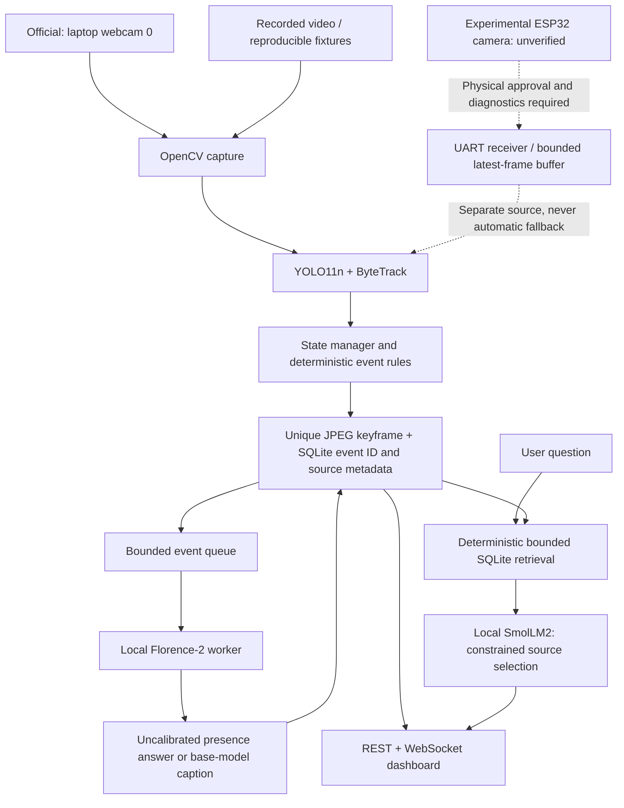

# SentinelAI

Local video intelligence with YOLO11n, ByteTrack, event evidence, Florence-2 and source-linked local LLM answers.

SentinelAI processes a laptop webcam or a video file on a Windows laptop. It tracks objects, derives deterministic events, saves evidence in SQLite/JPEG, and serves a live dashboard through FastAPI and WebSocket. Inference runs locally; the ESP32 is a telemetry device, not the inference host.

## Features

- YOLO11n detection and persistent ByteTrack identities.
- Entry, exit, zone change, loitering, rapid-motion and unattended-object heuristics.
- Separate live annotated preview and saved event evidence/history.
- Event-triggered Florence-2 checks in a bounded asynchronous queue.
- Local SmolLM2 event QA with validated event references and factual text rendered from SQLite.
- Truthful model lifecycle/error states, preview freshness and source provenance.
- Preserved ESP32 telemetry firmware, isolated UART probes and a temporary programming bridge.

## Architecture




See [architecture](docs/ARCHITECTURE.md) and [known limitations](docs/KNOWN_LIMITATIONS.md).

## Prerequisites

- Windows PowerShell, Git and Python 3.13 (the version used for local validation).
- A working laptop webcam, or a local video that you are authorized to use.
- Enough disk and RAM for PyTorch, YOLO and the selected local models. The tested CPU laptop had approximately 16 GB RAM; concurrent model loading can be slow.
- Microsoft Edge and Playwright only for browser verification; PlatformIO only for firmware builds.

Dependencies are pinned to the tested environment. A successful run on another machine still requires installation and model setup below. No API key, cloud inference service or Ollama server is required.

## Windows installation

From a clone of this repository:

```powershell
Set-Location <your-clone-directory>
py -3.13 -m venv .venv
& .\.venv\Scripts\python.exe -m pip install --upgrade pip
& .\.venv\Scripts\python.exe -m pip install -r requirements-local-ai.txt
& .\.venv\Scripts\python.exe -m pip check
Copy-Item config.example.yaml config.yaml
```

`config.yaml` is ignored and remains machine-local. The committed `config.example.yaml` disables ESP32 access. The normal launcher uses `config.presentation.yaml`, which enables both local models, binds to localhost and disables serial. Existing local configuration is not overwritten by repository cleanup; omit `Copy-Item` if you already have one.

## Model setup

Weights, private adapters and model caches are deliberately excluded from Git. Review each upstream model's license before using or redistributing it.

1. **YOLO11n**: the application expects `yolo11n.pt` in the repository root. An explicit first-time download through the installed Ultralytics package is:

```powershell
& .\.venv\Scripts\python.exe -c "from ultralytics import YOLO; YOLO('yolo11n.pt')"
```

2. **Florence-2**: install the isolated compatibility overlay and explicitly download the public base model. The overlay preserves the main environment's Transformers version.

```powershell
& .\.venv\Scripts\python.exe -m pip install --target data/evaluation/vlm_runtime --no-deps -r requirements-vlm-compat.txt
& .\.venv\Scripts\python.exe -c "from huggingface_hub import snapshot_download; snapshot_download('microsoft/Florence-2-base-ft')"
```

An optional local adapter can be supplied under `backend/vlm/models/sentinel-vqa-v1/best`, or set `vlm.adapter_dir: null` in `config.presentation.yaml` to select the base model explicitly. The adapter is not included or required for base-model operation. If a requested adapter is absent the worker exposes its base-model fallback warning.

3. **Local LLM**: explicitly cache `HuggingFaceTB/SmolLM2-135M-Instruct`:

```powershell
& .\.venv\Scripts\python.exe scripts/download_llm.py --download
```

After setup, model workers use offline/cache-only loading. Missing files, loading errors and inference timeouts remain visible. See [local models](docs/LOCAL_MODELS_SETUP.md) for details.

## Configure and launch

The official presentation source is the laptop webcam. Both Florence-2 and SmolLM2 remain enabled:

```powershell
Set-Location D:\SentinelAI
& D:\SentinelAI\scripts\run_presentation.ps1 -Source 0
```

The zero-argument launcher also selects webcam `0`. Explicit webcam selection bypasses ESP32 hardware preflight and blocks physical serial access. A failed webcam never silently changes to a video or another source.

For a local video:

```powershell
& .\scripts\run_presentation.ps1 -Source 'C:\path\to\your-video.mp4'
```

Open **http://127.0.0.1:8010**. The launcher prints the log location; `data/logs/presentation_latest.json` records the latest command and log path. Ctrl+C stops the application.

Both models are enabled by default. The launcher validates the source/configuration and independently blocks serial opening. For an explicit lightweight opt-out, use `-NoVLM -NoLLM`. `-Check` validates without starting the application. Camera indices are opened only when the application starts.

### Recorded demo

The private laptop recording is not redistributed: its privacy/redistribution rights were not established for publication. Keep your own authorized clip at `data/demo/webcam.avi` and explicitly pass `-Source data/demo/webcam.avi`. The zero-argument launcher selects webcam 0. Explicit `-Source esp32` retains its fail-closed hardware gates; it does not fabricate frames.

Recorded-video loops reset temporal state. Repeated entries in replay history are not unique real-world arrivals. Use a webcam or an appropriately long video to demonstrate dwell naturally. Source labels distinguish video files, webcams and the unverified ESP32 camera.

### Screenshots

Screenshots are generated locally and excluded from Git because they can contain people, private video and event details. To generate your own end-to-end screenshot, first run:

```powershell
& .\scripts\run_presentation.ps1 -MaxSeconds 240
```

Then in another terminal:

```powershell
& .\.venv\Scripts\python.exe scripts/verify_presentation.py
```

This optional real-model/browser check expects the laptop webcam by default. Its results and screenshot are saved in a new directory under `data/presentation/validation_*`; recorded-video validation requires `--expected-source video_file`. Only publish screenshots you have permission to share.

## Tests and firmware builds

```powershell
& .\.venv\Scripts\python.exe -m pytest -q -p no:cacheprovider
# Optional browser and firmware tooling:
& .\.venv\Scripts\python.exe -m pip install -r requirements-verification.txt
& .\.venv\Scripts\python.exe -m platformio run --project-dir esp32
& .\.venv\Scripts\python.exe -m platformio run --project-dir esp32/uart_probe
& .\.venv\Scripts\python.exe -m platformio run --project-dir esp32/camera_uart_probe
& .\.venv\Scripts\python.exe -m platformio run --project-dir esp32/uart_programmer_bridge
# Inert camera-driver reference only; not a physical camera target or upload image:
& .\.venv\Scripts\python.exe -m platformio run --project-dir esp32/camera_capture
```

Firmware commands compile only; they do not upload. Ordinary tests use synthetic images/records and mocked model/serial responses. They do not demonstrate physical hardware or model quality. Fresh results and the distinction between unit tests, genuine inference, browser checks and historical validation are recorded in [final validation](docs/FINAL_VALIDATION.md).

## ESP32 status and safe setup

The original telemetry sketch is preserved under `esp32/SentinelTelemetry`. Historical physical tests established USB telemetry, ping and alert acknowledgements on the primary DevKit. No physical actuator or on-device AI is claimed.

**ESP32 camera integration is experimental. Physical sensor initialization, firmware flashing, genuine JPEG reception, continuous video, dashboard display, and AI processing of real ESP32-origin frames have not been verified end to end.** Camera-board power/regulator routing, the second DevKit's supply/current budget, UART0/IO0/reset routing and programming controls remain unverified. Real camera PING/PONG, initialization/PID and image capture have not passed. COM9 must not be treated as a direct camera programmer.

Prepared host camera-stream framing/decoding and explicit `-Source esp32` now exist, but camera mode fails closed until independent physical approval and live diagnostics pass. `scripts/check_esp32_camera.py` reports the current blocked stages without opening serial. Installed probe/telemetry firmware does not emit capture packets. A gated `esp32/camera_capture` core now implements real driver/PID/JPEG transport logic offline, but its included reference image is deliberately inert and is not a build for the unidentified physical camera.

The UART probe explicitly uses primary RX16/TX17; the camera responder and binary bridge are separate, compile-tested projects. Do not flash, erase, energize or alter wiring based on compilation. Keep real telemetry and fresh recoverable backups intact. Follow [ESP32 setup and stage gates](docs/ESP32_SETUP.md).


## Pipeline and analysis lifecycle

YOLO11n and ByteTrack share one model invocation per frame; the standalone `Detector` remains a compatibility utility. Confidence defaults to 0.5 and IoU to 0.7. ByteTrack IDs connect boxes to state histories. The state manager computes motion using elapsed timestamps (normalized to a 30 FPS reference); loitering and unattended durations use elapsed time. Rules detect entry, exit, zone changes, dwell, rapid motion and unattended-object candidates. These are heuristics, not established intent or ownership. Disconnections and video rewinds reset temporal state.

Each deterministic event is inserted into SQLite with its source metadata and a unique saved JPEG path. Missing image writes leave an event with no evidence reference. Selected event types enter a bounded priority queue, deduplicated while pending. Queue overload is explicitly skipped. The worker checks the queued image SHA-256 and the event association; results retain event ID, task, model, prompt, checked time, hash, raw observation and error/status. Shutdown marks pending work cancelled. Failed checks can be retried from the API; inference timeouts require restarting the worker/application.

**Florence-2** processes the selected saved image. With the local trained adapter it retains the training-compatible yes/no/unknown prompt. Without that adapter it uses the supported `<DETAILED_CAPTION>` task and parses its task-keyed output; the presence answer remains `unknown`. The base caption has a bounded 64-token minimum budget. This task follows the [upstream Florence model card](https://huggingface.co/microsoft/Florence-2-base-ft). Still images cannot verify running, ownership, dwell time or an exit. Successful output stays `inconclusive`; confidence is never fabricated. Invalid inputs, corrupt images, malformed output, dependency errors and model timeouts remain distinguishable from success.

**SmolLM2** receives bounded retrieved event metadata, missing-evidence indicators and available Florence observations labeled unverified. It selects a supplied event ID through constrained JSON generation. The host validates the response and renders facts and links from SQLite. Records are removed whole to fit 1,536 prompt tokens; generation defaults to 96 tokens. Missing records, invalid selections and model errors return honest recorded-fact fallbacks. No previous LLM prose is reused as evidence. This deliberately limited implementation does not generate an unconstrained investigative narrative or infer identity/intent. Florence observes images; SmolLM2 ranks language context; deterministic rules remain responsible for events. Neither AI output independently proves an event occurred.

## Configuration and storage

The launcher always uses `config.presentation.yaml`. Direct `python -m backend.main` uses ignored `config.yaml`, or `--config PATH` / `SENTINEL_CONFIG`. `SENTINEL_LLM_MODEL` overrides the configured LLM model ID. Paths resolve against the repository root.

| Section | Relevant settings |
| --- | --- |
| `camera` | `source`, `width`, `height`, `fps`, `max_read_failures`, `reconnect_delay_s` |
| `detector` | `model_path`, `confidence_threshold`, `iou_threshold`, `device` |
| `event_engine` | `zones`, `missing_timeout_s`, `loitering_threshold_s`, `running_speed_px_per_frame`, association/separation distances, `unattended_threshold_s` |
| `vlm` | `enabled`, `base_model_id`, `adapter_dir`, `runtime_path`, `queue_max_size`, `event_types`, token/load/inference limits |
| `llm` | `enabled`, `model_id`, `context_event_limit`, `max_new_tokens`, `cpu_threads`, timeout limits |
| `database` / `evidence` | `path` / `output_dir` |
| `api` / `esp32` | host/port; optional telemetry configuration (disabled for presentation) |

Supported presentation sources: integer webcam index, existing video file, HTTP(S) stream, explicitly gated `esp32`. Recorded video loops by default; `-NoLoop` stops at EOF. Backend direct mode also accepts RTSP. There is no automatic source substitution. Video timestamps advance from media position; loop boundaries start a new temporal segment. Webcam processing is synchronous with YOLO; slow AI runs separately in subprocesses. The implementation makes no capture FPS or latency guarantee.

Presentation storage: `data/presentation/sentinelai.db` and `data/presentation/events/`. Direct defaults: `data/sentinelai.db` and `data/events/`. SQLite migrations are additive; reads and writes share a serialized connection. There is no automatic evidence retention policy; monitor disk use and archive data while the application is stopped.

## Confirmed interfaces

| Method / endpoint | Purpose |
| --- | --- |
| `GET /` | Dashboard |
| `GET /api/health`, `GET /api/models` | Source freshness, pipeline and model lifecycle/errors |
| `GET /api/events?limit=50&event_type=LOITERING` | Bounded event history; optional `query` description substring search |
| `GET /api/events/{event_id}` | Record, evidence reference and VLM metadata |
| `GET /api/stats`, `GET /api/event_types` | Counts and supported types |
| `POST /api/events/{event_id}/verify` | Queue saved evidence; enforce configured evidence directory |
| `POST /api/llm/query` | JSON `question`, optional `event_type`, `limit` (1 to 20) |
| `GET /api/frame.jpg` | Fresh annotated preview; stale frames return 404 |
| `GET /evidence/{filename}` | Saved JPEG evidence |
| `WS /ws/stream` | Live track/event/frame metadata; preview images use REST |

QA examples: "When was the latest loitering event?", "Show event #42", "What happened in the last five minutes?". Around-time queries require an ISO timestamp with explicit timezone. Retrieval is deterministic keyword/time/ID filtering, not general semantic search. A query about unavailable facts returns records plus explicit uncertainty rather than invented facts.

## Repository map

```text
backend/       camera, tracking, state/events, evidence, SQLite, AI workers, API
 dashboard/    browser UI (index.html)
 scripts/      presentation, validation, model setup, experimental diagnostics
 tests/        deterministic regression tests with synthetic/mock inputs
 docs/         operations, validation, model and hardware guides
 esp32/        preserved telemetry, camera references, probes and bridge firmware
 config.presentation.yaml   full-AI webcam demo on localhost:8010
 requirements*.txt          host and isolated Florence dependency pins
```

The experimental camera milestones remain: resolve carrier/power/sensor/GPIO identity with competent electrical inspection; authorize a separate hardware session; identify and build the correct target; verify flashing, sensor initialization and one genuine JPEG; then establish continuous frames, dashboard provenance and local AI processing. No physical step is part of this presentation task.

## Limitations and troubleshooting

- **Video missing/unreadable:** supply an authorized local file or use `-Source 0`; check permissions and codec support.
- **Camera unavailable:** close other webcam applications and check Windows camera permissions. Reconnect/error states are exposed; stale frames are hidden.
- **Port 8010 busy:** stop the existing backend before starting another launcher.
- **Models loading/error:** inspect the dashboard and `data/logs/vlm-worker.log` / `llm-worker.log`. Ready means weights loaded; completed-inference counters establish requests actually completed. Missing weights need the explicit setup commands above.
- **Florence compatibility:** install the pinned overlay; do not downgrade the main environment globally. Presence answers are uncalibrated and do not validate elapsed activity.
- **LLM scope:** the small LLM selects retrieved event IDs; it is not a general chatbot. Factual answer text comes from stored records, with a visible fallback on model failure.
- **CPU contention/queue full:** FPS varies; event checks may be skipped by the bounded queue. No throughput guarantee is claimed.
- **Accuracy:** representative detector/event/tracker field accuracy is not measured. Existing adapter evaluation did not establish an improvement. See [accuracy evaluation](docs/ACCURACY_EVALUATION.md).
- **Local-only security:** use one backend worker and the localhost presentation binding. This is not an authenticated public hosting configuration.

## Repository hygiene and licensing

Source, tests, documentation, firmware and dependency manifests are versioned. Environments, caches, secrets, local configuration, databases, logs, evidence, videos, datasets and model weights are excluded. Do not add those files with `git add -f`.

This repository preserves its existing Git history. Generated files previously committed in that history remain there; the cleaned tip stops tracking them without deleting local copies. No project redistribution license has been selected. Third-party models and dependencies retain their upstream license terms.
