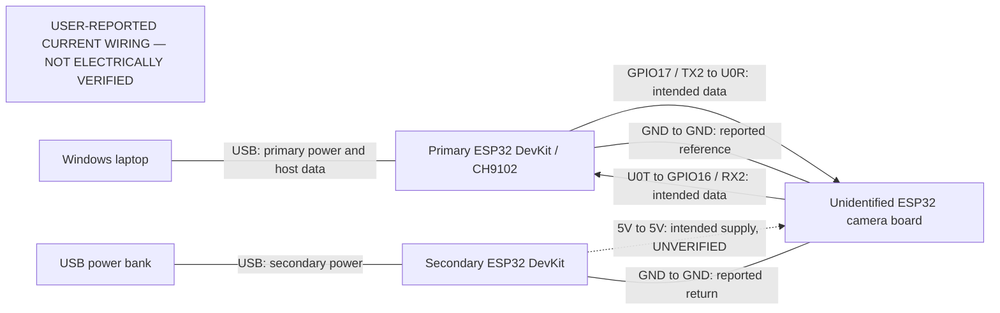

# Hardware setup and verification status

**USER-REPORTED CURRENT WIRING — NOT ELECTRICALLY VERIFIED**

This is the authoritative hardware description for the 23 October 2026 release pass, based on the latest supplied requirements. No physical hardware operation was performed during this pass: no COM9 access, serial transmission, flashing, erase, reset, power cycle or wiring change. The camera remains physically unverified. Earlier reports describe other wiring experiments; they do not override this account or prove the assembly's present electrical state.

Historical notes include a reported camera overheating incident. That observation is not a diagnosis. Keep the assembly unpowered pending assessment by a competent electronics lab. The software demonstration uses a laptop webcam or an explicitly selected local recording.

## Three boards, three roles

| Component | Reported identification and role | Verification boundary |
| --- | --- | --- |
| Primary ESP32 DevKit | ESP32-WROOM-32; ESP32-D0WD revision 1; approximately 4 MB flash; CH9102 USB-to-UART; previously COM9. Laptop USB connection and `SentinelTelemetry` telemetry firmware. Reported UART2 wiring to camera. | Historical identification, not a fresh device read. Preserve its flash and recovery copies. COM9 is not an established direct camera programmer. |
| Secondary ESP32 DevKit | USB power bank connection; intended power supply to camera through `5V` and `GND`. | Supply capability, voltage under load and available current **not verified**. Red LED reportedly blinked once then went off; board felt slightly warm. Neither observation establishes a defective LED or board. |
| Separate camera board | Camera ribbon/FPC connector, microSD slot; labels `U0R`, `U0T`, `IO0`, `5V`, `VCC`, `3V3`, `GND`, `IO16`. | Resembles an AI-Thinker-style ESP32-CAM. Exact revision, schematic, sensor, regulator routing and GPIO map remain unconfirmed. |

Camera ribbon marking appears to read `TY-OV3660-2.1M-V3`. Possible regulator marking is `1117C 33 D420`. A memory marking appears consistent with an AP Memory 6404L-family device. These are reported visual observations, **not confirmed part identification**, measured memory capacity, sensor PID or a verified pin map. Do not select a camera firmware target solely from these markings.

## Reported power and UART wiring

| Primary ESP32 | Camera board | Intended signal direction |
| --- | --- | --- |
| GPIO17 / TX2 | U0R | Primary transmits → camera receives |
| GPIO16 / RX2 | U0T | Camera transmits → primary receives |
| GND | GND | Shared signal reference |

| Secondary ESP32 | Camera board | Intended purpose |
| --- | --- | --- |
| `5V` | `5V` | Camera power; path and current capacity unverified |
| `GND` | `GND` | Power return / common reference |

TX means transmit and RX means receive: the sending side connects to the receiving side. A wire report does not establish continuity, compatible electrical levels or functioning communication. The primary's current telemetry source does not activate a UART2 camera relay.

The diagram is a record of reported connections, not approval to energize or reproduce them. The primary connects to laptop USB; the secondary connects to bank USB. Power, runtime UART communication and programming are separate functions. Power alone supplies neither camera capture firmware nor sensor initialization nor an image stream. Do not join positive supply rails or infer a safe input from a header name.

## Equipment and unknowns

Available: Windows laptop, VS Code, two ESP32 DevKits, separate camera board, USB power bank, USB cables for the DevKits, female-to-female, male-to-male and male-to-female jumper wires.

Currently unavailable or unverified: USB cable with exposed camera pin-header connections, separate USB-UART programmer, verified programming/reset wiring, matching camera schematic, independently measured continuity, voltage and current budget. A separate programmer is **not yet established as necessary**: the actual DevKit USB-UART routing and bridge capabilities must first be examined. Its absence also does not establish that the present arrangement can program the camera.

A future electrical assessment must identify the carrier/revision, regulator input/output connections and sensor/FPC orientation, check unpowered continuity and common-ground routing, establish safe supply and logic levels, and measure supply behavior/current budget under a controlled load. Do not substitute a guessed generic ESP32-CAM pinout. Record instrument readings and their conditions separately from software observations.

## Programming and boot mode

Programming requires a supported data connection, correct boot-mode control, an appropriate reset sequence, a confirmed target/GPIO map and safe power. On the classic ESP32, GPIO0 low during reset selects the serial bootloader; this general rule does **not** establish this board's IO0/reset routing. Do not blindly short header pins or permanently hold IO0 low. Follow the matching board schematic after electrical assessment. USB serial opening can affect reset lines on some DevKits.

References: [Espressif boot-mode selection](https://docs.espressif.com/projects/esptool/en/latest/esp32/advanced-topics/boot-mode-selection.html), [Arduino-ESP32 UART API](https://docs.espressif.com/projects/arduino-esp32/en/latest/api/serial.html). These describe ESP32 behavior, not the unidentified carrier's wiring.

## What the firmware and host actually implement

| Source or tool | Implemented capability | What compilation does not prove |
| --- | --- | --- |
| `esp32/SentinelTelemetry/SentinelTelemetry.ino` | USB JSON telemetry, ping and software alert acknowledgements. | No camera image forwarding, UART2 relay or current camera communication. Preserve this source, current flash and recovery copy. |
| `esp32/uart_probe` and `esp32/camera_uart_probe` | Separate diagnostic PING/PONG protocol. | Not sensor initialization, sensor identification, JPEG capture or image transport. |
| `esp32/uart_programmer_bridge` | Separate compiled binary bridge preparation. | Not physically tested as a camera programmer or streaming bridge. Existing CLI baseline does not authorize its use. |
| `esp32/camera_capture` | Gated driver/PID/JPEG implementation with an **inert reference** build. | Not deployable firmware for the unidentified board; verified deployment config is deliberately excluded. |
| `esp32/camera_first_jpeg_hypothesis` | Separately labelled AI-Thinker pin-map hypothesis. | Not board identification, a verified pin map or an approved upload target. Build only; never use it as evidence of a physical milestone. |
| Host SNC1 receiver / `Esp32CameraSource` | Bounded framing, CRC validation, JPEG decode and provenance integration, covered by simulated tests. | Cannot generate a JPEG when none is transmitted. Mocks/fixtures do not establish physical origin. |
| HTTP camera template under `esp32/camera` | Alternative source templates requiring verified pins and local secrets. | Not installed or verified streaming firmware. |

## Required milestones for actual video

All physical milestones below remain incomplete for this release pass. A later hardware session requires separate authorization and electrical assessment first.

1. Identify and verify camera carrier, sensor and GPIO map against reliable evidence.
2. Verify camera power path, regulator routing and available current.
3. Establish supported programming, boot-mode and reset routes.
4. Preserve primary telemetry firmware and a verified recovery copy before any programming plan.
5. Install the correctly targeted camera capture firmware through the supported route.
6. Initialize the sensor and record its actual driver-read PID.
7. Capture and transmit a genuine JPEG.
8. Receive and decode that JPEG on the laptop; establish source identity and packet integrity.
9. Verify continuous delivery with measured frame count, span, age, gaps and reconnections.
10. Display the feed and run the existing detector/tracker/event/AI path; inspect event and image provenance.

Successful ROM communication would not prove sensor initialization. A PID would not prove capture. A decoded image would not establish continuous video. A compile or unit test proves none of these physical stages.

See [firmware development](ESP32_SETUP.md), [first-JPEG evidence workflow](ESP32_FIRST_JPEG.md), [architecture](ARCHITECTURE.md) and [webcam demo](DEMO_GUIDE.md). Local backups under ignored `data/` remain local and untouched. Historical reports are preserved under [hardware history](history/README.md).
