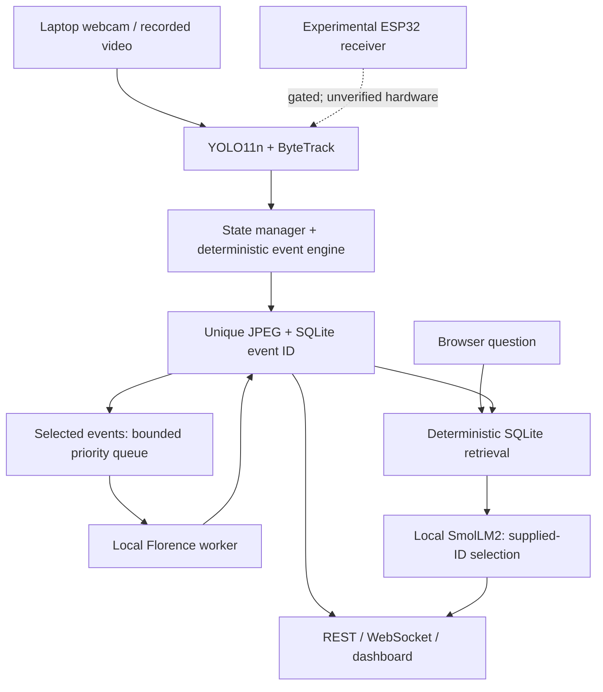
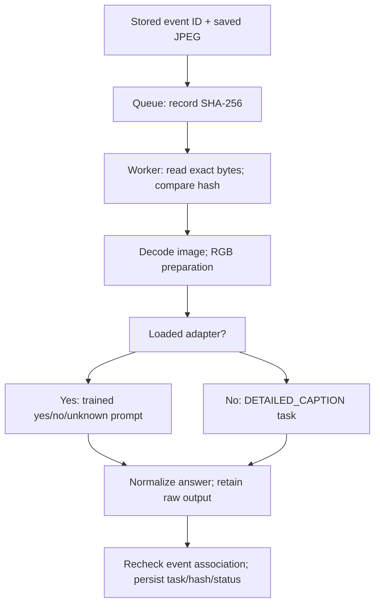
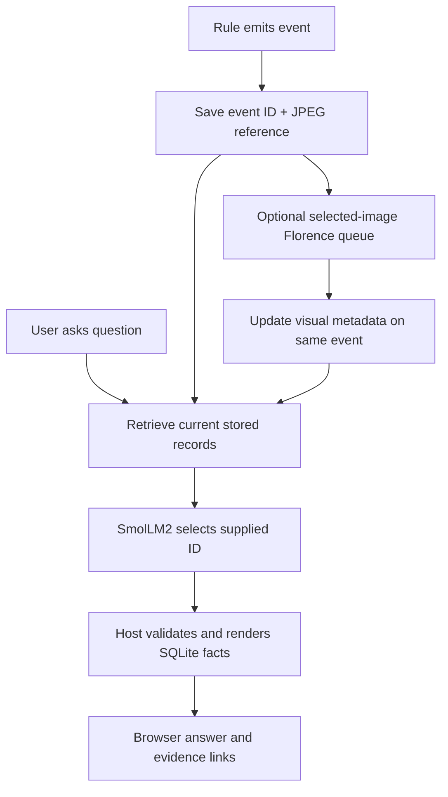

# SentinelAI

## Complete technical presentation and viva preparation

**A teaching guide to the implementation in this repository**

Prepared on 20 October 2026. Code baseline: `10d370f`. Official demonstration: the laptop webcam. This guide explains the working software, the evidence behind its reported results, and the boundaries of the experimental ESP32 camera extension.

### The five ideas to understand first

1. **YOLO11n detects:** it gives an object class, a confidence score and a box in one image.
2. **ByteTrack associates:** it links detections across frames using temporary track IDs.
3. **Rules decide events:** the application checks zone transitions, elapsed dwell, motion and unattended-object heuristics.
4. **SQLite and JPEGs preserve evidence:** each stored event has an ID and an optional keyframe reference.
5. **AI adds limited context:** Florence processes selected saved images; SmolLM2 selects supplied event references. The host renders factual answers from SQLite.

> **The most useful sentence for the viva:** “Deterministic rules generate the event; saved evidence makes it traceable; the language models add unverified visual observations or validated source ordering.”

### How to study tonight

Read Chapters 1–3 for the whole system, Chapters 4–10 for the technical pipeline, and Chapter 11 for the important training/dataset distinction. Practise the script in Chapter 15, run the safe checklist in Chapter 16, then answer the viva bank aloud. Use the last page for morning revision.

**Evidence labels used throughout:** IMPLEMENTED means present in inspected code. TESTED means exercised by automated tests. REAL INFERENCE means installed model weights actually ran in the recorded validation. WEBCAM/BROWSER means an actual laptop camera/browser workflow was exercised. HARDWARE UNVERIFIED means physical ESP32-camera success has not been established. ILLUSTRATIVE means invented numbers used only for teaching.

This is a study document, not a new accuracy benchmark. Existing validation artifacts were inspected; the regression suite was rerun for this documentation audit. The camera and language models were not replayed or retrained just to write the guide. No working application code was changed.

<!-- pagebreak -->

# Contents and evidence map

| Chapter | Study topic | Page |
| --- | --- | --- |
| 1 | Project overview | 3 |
| 2 | Architecture and one-frame walkthrough | 4 |
| 3 | Video input and frame handling | 5 |
| 4 | YOLO11n object detection | 6 |
| 5 | ByteTrack tracking | 7 |
| 6 | Events, zones and state | 8 |
| 7 | SQLite and evidence | 9 |
| 8 | Florence-2: workflow, interpretation and questions | 10–11 |
| 9 | SmolLM2: retrieval, constraints and questions | 12–13 |
| 10 | How the AI components work together | 14 |
| 11 | Dataset, training and model-weight audit | 15–16 |
| 12 | REST, WebSocket and dashboard | 17 |
| 13 | ESP32 telemetry, camera and hardware limits | 18–19 |
| 14 | Tests, results and evaluation | 20 |
| 15 | Spoken presentation and two-minute summary | 21–23 |
| 16 | Live-demo plan and troubleshooting | 24 |
| 17 | Faculty viva bank: 48 questions by difficulty | 25–28 |
| 18 | Glossary, formulas, recap and final revision | 29–30 |

### Which evidence supports which claim?

| Evidence | What it can establish | What it cannot establish |
| --- | --- | --- |
| Source/configuration | Interfaces, rules, configured limits | That a hardware device worked |
| Unit tests with mocks | Tested parsing, state transitions and failure handling | Neural model accuracy |
| Real-model reports | Actual loading/generation for recorded inputs | Reliable scene understanding in all conditions |
| Webcam/browser reports | Real host camera, preview, events, evidence, QA and connections | ESP32-origin video |
| Firmware build logs | Software compiles for the stated build environment | Installation, sensor boot or JPEG transmission |
| Historical hardware reports | What was observed in that earlier setup | Current camera health or untested stages |

**Priority when documents disagree:** current executable code and presentation configuration describe present behavior. `docs/FINAL_VALIDATION.md` records the final engineering run. Older sections of `LOCAL_AI_INTEGRATION_REPORT.md`, `ESP32_SETUP.md` and `ACCURACY_EVALUATION.md` retain historical defaults and results. They are not new runs. For example, the presentation profile now enables both models, although an older evaluation document says the VLM was disabled by default.

No PowerPoint file was available in the repository. The talk therefore follows a practical sequence and the known image placeholders: code on slide 9, results on slide 10, and final live demo on slide 12. It does not pretend to reconstruct every existing slide title.

<!-- pagebreak -->

# 1. Project overview

### What problem are we solving?

A video contains many frames, but a person reviewing an incident needs a smaller set of meaningful records. A detector saying “person” thirty times does not tell us whether the same tracked object remained in a zone, disappeared, or triggered a configured rule. SentinelAI connects visual observations over time, creates rule-defined events, saves supporting keyframes and exposes the history through a local dashboard.

Think of the detector as a person looking at one photograph, the tracker as a temporary label attached across photographs, the event engine as a checklist with a clock, and SQLite as the notebook. The analogy has a limit: a track ID is not a person's name, and a rule label is not a judgment of intent.

### Five stages that must not be confused

| Stage | Example question | Actual output |
| --- | --- | --- |
| Detection | What is visible now? | Class, confidence and pixel box |
| Tracking | Which current box belongs to an existing track? | A `Track` with a temporary integer ID |
| Event detection | Has a configured condition become true? | An `Event`, such as `LOITERING` |
| Persistence | Can I inspect this later? | SQLite row ID plus optional JPEG path |
| AI assistance | What visual observation or source selection is available? | Florence metadata or validated SmolLM2 source ordering |

### One person, from appearance to answer

**ILLUSTRATIVE:** a webcam frame contains a person whose box center is inside the configured `entrance` rectangle. `Tracker.update(frame)` calls Ultralytics detection and ByteTrack together, then converts their output to the project's `Track` dataclass. Suppose the returned ID is 7. `StateManager` remembers its first/last observation, position history and current box.

`EventEngine` sees that track 7 has changed from no recorded zone to `entrance` and creates `PERSON_ENTERED`. The main loop saves the unannotated current frame as a JPEG, inserts the event into SQLite, and obtains a database event ID. **Track ID 7 and database event ID are different identifiers.**

In the presentation profile, entry is one of the selected VLM event types, so the event's image may enter the background Florence queue. A later user question retrieves matching SQLite records. If SmolLM2 is ready, it selects from supplied event IDs; the host validates the selection and builds the factual answer and evidence links. Nothing requires the question to wait for Florence to finish.

### What is ready to present?

The host webcam pipeline, tracking, deterministic rules, SQLite/JPEG evidence, REST/WebSocket dashboard and local-model integration have software and recorded live-validation evidence. The physical ESP32 camera remains experimental. Telemetry acknowledgements, camera firmware compilation and simulated JPEG packets must not be presented as real camera video.

**Chapter recap:** the project's contribution is the integration and traceability of these stages, not the invention of YOLO, ByteTrack or a foundation model.

**Source trail:** `backend/main.py`; `schemas/track.py`; `schemas/event.py`; `config.presentation.yaml`; `docs/FINAL_VALIDATION.md`.

<!-- pagebreak -->

# 2. Architecture and data flow



### Follow one frame through the real call chain

1. `CameraSource.read_frame()` returns a valid OpenCV BGR array or a failure indication. Source selection is explicit; webcam 0 does not silently turn into a file or ESP32 stream.
2. `Tracker.update()` invokes `model.track(..., persist=True, tracker="bytetrack.yaml")`. The library performs detection and association. Main does not run a second standalone detector call.
3. `StateManager.update(tracks, timestamp)` updates positions and temporal state. `EventEngine.update(states, timestamp)` evaluates deterministic rules.
4. For every emitted event, `KeyframeCapture.save()` writes a JPEG. `EventDatabase.save_event()` inserts the event, evidence path and source metadata, returning the event ID. A failed image save leaves the event with no image reference.
5. The event is offered to `AIManager.enqueue_event()`. Only configured types qualify automatically. Queueing is conditional, prioritized and deduplicated; inference does not occur for every video frame.
6. Main broadcasts tracks/events as JSON and periodically creates an annotated preview JPEG. The browser retrieves the preview through HTTP and receives live metadata through WebSocket.

### Which work is asynchronous?

Capture, YOLO/ByteTrack, state updates, event rules and evidence/database writes execute in the main processing loop. Webcam acquisition is **not** an independent latest-frame capture thread. Slow YOLO or disk writes can therefore slow that loop. The experimental UART receiver has its own bounded latest-frame acquisition path.

Uvicorn runs an asyncio server on a separate thread. Florence and SmolLM2 load once into separate managed Python subprocesses. A host worker drains the VLM event queue. Browser QA runs the blocking assistant operation through `asyncio.to_thread`, so a generation request does not occupy the API event loop for its entire duration.

**Important correction to a tempting slide:** do not draw Florence → SmolLM2 → dashboard as an unconditional per-frame chain. The dashboard can work while models load; Florence updates a saved record later; SmolLM2 runs on a user question and uses whatever verified-as-recorded context is currently available.

**Chapter recap:** one synchronous perception path branches into persistence, live display and optional asynchronous AI work. `AIManager`, rather than the older standalone `EventVerifier` helper, is the orchestration used by main.

<!-- pagebreak -->

# 3. Video input and frame processing

### What is a frame?

A frame is a rectangular array of pixel values. A normal webcam frame here has height × width × 3 channels, with `uint8` channel values from 0 to 255. OpenCV supplies channels in BGR order. A requested 1280 × 720 capture therefore has array shape `(720, 1280, 3)`; the request does not guarantee that every device supplies exactly that size or rate.

`CameraSource` opens integer source `0` using `cv2.VideoCapture(0)`. For non-file sources it requests width 1280, height 720 and 30 FPS. It checks `isOpened()` and raises `CameraError` if opening fails, releasing the failed handle. Reopening first closes the old handle; shutdown releases capture and closes the backend's resources.

### Source and time are part of the evidence

| Input | How selected | Time/continuity behavior |
| --- | --- | --- |
| Laptop webcam | `-Source 0` | Host UTC time for a processed frame; capture and YOLO share the main loop |
| Recorded video | Existing path | Media position relative to a host-time origin; rewinds reset temporal state |
| Repeated-photo fixture | Explicit fixture video | Real model inference can run, but motion/scene realism is artificial |
| HTTP(S)/RTSP source | Explicit URL where supported | Network capture has bounded open/read timeouts; origin must be stated honestly |
| Experimental ESP32 UART | Explicit gated `esp32` | Receiver metadata/session information; physical stream not verified |

**ILLUSTRATIVE:** a 720p array is valid, so main assigns a timestamp and passes the original array to tracking. Before displaying boxes, the preview path copies the frame and draws annotations. The stored event JPEG is saved earlier from the original frame. This is why a saved evidence image need not contain drawn boxes.

### Failures and freshness

Successful reads still require a nonempty, three-channel uint8 array. A failure does not become a fake black frame. The camera counts consecutive failures; for a live source, ten failures trigger closure, a two-second wait and a reopen attempt. Failed reopen raises an actionable error. A non-looping file ends at EOF; a looping file seeks back and rejects an undecodable first frame.

Main marks continuity lost after capture/inference failures and resets ByteTrack, state and event memory on recovery. Video rewind also starts a fresh temporal segment. These resets protect against carrying a previous segment's dwell time into unrelated footage; they may also issue new IDs and new entry events.

The API keeps preview age and sequence. A preview older than five seconds, or one without a currently healthy camera state, is not served as live by `/api/frame.jpg`. The browser hides stale/unavailable images and retries. This is display freshness, not a guarantee of low sensor-to-screen latency; host/driver buffers and synchronous processing still matter.

**Chapter recap:** an opened camera is not the same as arriving frames, and a WebSocket connection is not proof that the preview is current. Today's presentation uses the already validated laptop path because the physical camera board's electrical identity and image output remain unverified.

**Source trail:** `backend/camera/camera.py`; `backend/main.py`; `backend/api/routes.py`; dashboard `refreshPreview()`.

<!-- pagebreak -->

# 4. YOLO11n object detection

### From classification to localization

Image classification assigns a class to an entire image. Object detection additionally locates individual objects. YOLO is a family of learned detectors commonly expanded as “You Only Look Once.” This repository uses Ultralytics **YOLO11n**, the nano-size detection variant, rather than a classifier, segmentation model or face-recognition model. The upstream model documentation identifies the model family and pretrained detection classes. [Reference: Ultralytics YOLO11](https://docs.ultralytics.com/models/yolo11/).

In simple terms, neural feature extraction turns pixel patterns into useful internal features; prediction layers propose boxes and class scores. The installed Ultralytics wrapper handles resizing/letterboxing, tensor conversion and post-processing. SentinelAI passes the valid OpenCV frame rather than reimplementing the network or manually resizing every frame first.

### What the actual wrapper does

```python
results = self.model.track(
    frame, persist=True, conf=0.5, iou=0.7,
    device=self.device, tracker="bytetrack.yaml",
    verbose=False,
)
```

This excerpt shows the effective defaults; the source takes the values from configuration. `Tracker` checks the local `yolo11n.pt` file, checks the `lap` dependency and loads one YOLO instance. It converts returned classes, scores, xyxy boxes and IDs into project `Track` records. The older `backend/detector/detector.py` utility is not separately called in main.

The local checkpoint reports 80 class names, detection task, scale `n`, `end2end=False`, COCO training metadata and a 2024 checkpoint date. Its training metadata refers to upstream `coco.yaml`. No custom SentinelAI YOLO training run was found. The checkpoint's recorded upstream epochs are **not** epochs run by this student project.

### Worked detection: ILLUSTRATIVE, not a measured result

Suppose a frame has a person box `(100, 80, 300, 480)` with score `0.87`. The top-left corner is `(100,80)`, bottom-right `(300,480)`, width 200 pixels, height 400 pixels and center `(200,280)`. The class label is looked up through the loaded model's class names. The score passes the configured 0.5 filter; it is not proof that the event “loitering” is 87% certain.

The installed detection predictor calls non-maximum suppression. In outline, NMS reduces overlapping duplicate candidates using scores and an IoU threshold; SentinelAI supplies `iou=0.7`. This NMS threshold is separate from ByteTrack's association settings. Empty result lists, missing boxes and absent assigned IDs produce no tracks. Invalid frames are rejected; an inference exception is logged, that frame is skipped, and continuity is reset for the next successful frame.

### Quick faculty answers

**Why nano?** It is the small local model selected by the implementation; practical host resource use motivates it, but no comparative speed benchmark was established. **Does YOLO track?** The neural detector finds objects; this `model.track()` interface adds ByteTrack. **Is confidence accuracy?** No, a per-detection model score is not a measured dataset accuracy. **Did you train it on these images?** No custom detector training is established; local metadata points to pretrained COCO weights.

**Chapter recap:** YOLO supplies visual object candidates. It does not identify a person, measure criminal intent or create the temporal event by itself.

<!-- pagebreak -->

# 5. ByteTrack object tracking

### Why a box needs a continuing label

Two successive frames may contain slightly different boxes for the same moving person. Tracking associates those observations and gives the application a temporary ID on which to accumulate history. ByteTrack uses predicted track states and geometric association; its implementation maintains tracked, lost, removed and unconfirmed tracks. A Kalman filter predicts box motion/state, while matching compares candidates to those predictions. This is not biometric identification. [Concept reference: ByteTrack, ECCV 2022](https://github.com/FoundationVision/ByteTrack).

Conceptually, ByteTrack first associates stronger detections, then uses weaker remaining detections to recover some unmatched tracks rather than discarding every weak box. The **actual SentinelAI confidence configuration limits this benefit**: the detector filters at 0.5, while the installed tracker calls boxes below 0.25 its low-confidence group. Boxes already removed upstream do not reach that second association stage. Do not claim that this demonstration fully exploits every low-score detection described in the paper.

### Installed settings, not invented tuning

| Setting | Value | Meaning |
| --- | --- | --- |
| `tracker` / `persist` | `bytetrack.yaml` / `True` | Preserve association state between calls |
| `track_high_thresh` | 0.25 | First-stage detection-score grouping |
| `track_low_thresh` | 0.1 | Lower bound for weak-group candidates |
| `new_track_thresh` | 0.25 | Candidate threshold for a new track |
| `track_buffer` | 30 | Lost-track retention measured in tracker frame steps |
| `match_thresh` / `fuse_score` | 0.8 / true | First-stage matching-cost threshold / score fusion |

These values came from the installed Ultralytics 8.4.182 YAML; the project does not ship a custom tracker YAML. Match cost 0.8 is not “80% detector confidence” or necessarily a direct IoU cutoff. Main's returned tracks require assigned IDs. Missing detections can put a track into the library's lost state; after expiration it can be removed, and reappearance can receive a new ID. Frame-based retention is not a reliable one-second guarantee at variable processed FPS.

### IoU: a small numerical example

**Intersection over Union = intersection area / union area.** For hypothetical boxes A `(0,0,10,10)` and B `(5,0,15,10)`, each area is 100. Their overlap is 5 × 10 = 50; union is 100 + 100 − 50 = 150, so IoU = 1/3 ≈ 0.333. Greater overlap can support association, but motion prediction and the library's score/cost logic also matter.

### Six short viva checks

**1. Same ID means same named person?** No, it is a temporary trajectory label. **2. Who assigns IDs?** ByteTrack through Ultralytics; the wrapper exposes them. **3. Can IDs switch?** Yes, especially with occlusion, crossing objects or poor detections. **4. Is IoU measured in pixels?** It is a unitless area ratio. **5. What resets tracks?** Source interruption, inference discontinuity or recorded-video rewind triggers `Tracker.reset()`. **6. Does an empty frame end every event immediately?** No; track association and the application's one-second disappearance grace are separate mechanisms.

**Chapter recap:** YOLO asks what is in the frame; ByteTrack associates detections over time. Neither recognizes personal identity. Source: `backend/tracker/tracker.py`; installed `cfg/trackers/bytetrack.yaml` and `trackers/byte_tracker.py`.

<!-- pagebreak -->

# 6. Deterministic events, zones and state

### What makes an event deterministic?

A rule takes the observed track states and timestamps and follows explicit conditions. Its output is repeatable for the same input sequence. A rule firing can still be a poor interpretation of the world if the detections or assumptions are wrong. Deterministic means defined by code, not automatically accurate.

`StateManager` keeps each ID's current/previous box, first/last seen time, up to 100 center positions, velocity and missing/active state. `EventEngine` assigns zones using the **box center**. The default rectangle named `entrance` has inclusive boundaries `(0,0)` to `(1000,1000)` in source pixels. It is a configurable region label, not proof of a physical doorway or access-control boundary.

| Event | Actual trigger and main caveat |
| --- | --- |
| `PERSON_ENTERED` | Person center gains a zone where previous zone was absent; also fires for initial appearance already inside |
| `ZONE_CHANGED` | Non-null previous/current zones differ; default configuration has only one zone |
| `PERSON_EXITED` | Person leaves all zones, or is absent for the configured grace period; lost track does not prove physical exit |
| `LOITERING` | Person remains in a zone for at least 10 elapsed seconds; a flag prevents repetition in that dwell episode |
| `RUNNING` | Normalized image-motion magnitude reaches 15; clears below threshold, allowing later retrigger |
| `UNATTENDED_OBJECT` | A previously associated portable object remains stationary while its associated person is away/missing for at least 5 seconds |

### Worked dwell and speed examples: ILLUSTRATIVE

At 10:00:00, track 7 gains `entrance`, generating an entry record and setting `zone_entered_at`. At 10:00:09, nine seconds is below the dwell threshold. At 10:00:10.2, the first observed elapsed interval above ten seconds generates `LOITERING`; the next frame does not repeat it. Leaving/re-entering or changing zones resets dwell. This measures elapsed timestamps, not “300 frames must have passed.”

Velocity is computed as center displacement divided by `(elapsed_seconds × 30)`. A 60-pixel displacement over 0.2 seconds gives 10 reference-frame pixels, below 15. The normalization compensates for variable processing intervals but does not estimate meters/second. The event's displayed `px/frame` wording refers to this 30-FPS reference, not necessarily the last actual capture interval.

### Unattended objects and lifecycle limits

The candidate classes are bottle, backpack, handbag, suitcase and laptop. Association chooses a nearby person within 350 pixels; it does not establish ownership. A visible associated person within 250 pixels clears separation. Stationarity requires eight recent positions, net displacement no more than 60 pixels and total movement no more than 100 pixels. This sample window still depends on observation rate.

A short disappearance can recover without immediate exit. The event engine uses last-seen time with a one-second grace; long-retired state/history is pruned after `max(30 seconds, 2 × missing_timeout)`, retaining still-needed owner positions. Capture/inference discontinuities and video rewind clear temporal memory. Rule flags, prior-zone memory and pending IDs reduce duplicates; an ID change can still create another event.

**Chapter recap:** triggering, persisting, displaying and analyzing an event are separate actions. The LLM never calls an event-creation method. Source: `event_engine/event_engine.py`, `zone.py`, `state_manager/state_manager.py`, configuration defaults.

<!-- pagebreak -->

# 7. SQLite storage and evidence management

### A local notebook with stable references

SQLite stores rows in a local file without a separate database server. That fits this single-host demonstration. Presentation paths are `data/presentation/sentinelai.db` and `data/presentation/events/`; direct backend defaults use `data/sentinelai.db` and `data/events/`. They are machine-local runtime data, not training data or committed results. The published `screenshots/` images are selected presentation assets, not the database itself.

| Field group | Actual columns |
| --- | --- |
| Identity and rule | `id`, `event_type`, `track_id`, `class_name`, `zone` |
| Time and rule narrative | `timestamp`, `confidence`, `description` |
| Evidence/source | `evidence_path`, `source_metadata` |
| Visual output | `vlm_answer`, `vlm_raw_text`, `vlm_adapter`, `vlm_status` |
| Visual traceability | `vlm_prompt`, `vlm_model_id`, `vlm_checked_at`, `vlm_error`, `vlm_task`, `vlm_evidence_sha256` |

`id` is SQLite's autoincrement event key. It is distinct from the tracker ID and persists across process restarts. `source_metadata` is JSON text in storage and is decoded for retrieval. The event's `confidence` defaults to 1.0 for deterministic rules; **it is not calibrated event probability or the YOLO detection score**. VLM confidence returned by the application is null rather than invented.

### Example record: ILLUSTRATIVE and sanitized

```json
{
  "id": 42, "event_type": "LOITERING", "track_id": 7,
  "class_name": "person", "zone": "entrance",
  "timestamp": "2026-10-20T04:30:10+00:00",
  "evidence_path": "data/presentation/events/example.jpg",
  "vlm_status": "inconclusive", "vlm_answer": "yes",
  "vlm_task": "adapter_vqa", "vlm_error": null
}
```

This is a teaching subset of actual fields, not a real private record or guaranteed filename. JPEG filenames include time, event type, track ID and a random UUID to prevent collisions. Event-type validation prevents it from becoming a path component such as `../escape`.

### Consistency, retrieval and failure boundaries

Schema migration adds missing columns without dropping rows. The connection enables WAL and normal synchronous mode. A shared lock serializes reads and writes on this connection, and writes commit. Parameterized queries bind user values rather than interpolating them into SQL. Range comparisons use SQLite `julianday()` to compare timestamps across offsets. Description search uses SQL `LIKE`, not a semantic vector index.

JPEG write and SQLite insert are **not one cross-resource atomic transaction**. Image failure can leave an event without evidence; database failure after saving can leave an orphan image. The code does not provide automatic retention or guarantee recovery from every disk/database failure. Health can report a database error, and missing evidence prevents visual verification. The verify endpoint resolves the saved path, enforces the configured evidence directory and checks that the file exists. Static evidence serving is rooted in that directory.

The VLM records the JPEG's SHA-256 so a reviewer can link output to particular bytes. That detects replacement relative to the recorded digest; it does not prove who appeared in the image or cryptographically authenticate a physical sensor. **Chapter recap:** evidence association is a traceability guarantee within the checked workflow, not independent truth certification. Sources: `database/event_database.py`; `evidence/keyframe_capture.py`; retrieval and API modules.

<!-- pagebreak -->

# 8. Florence-2 VLM: the actual workflow

### What does “vision-language” mean?

A VLM relates image content to language. A detector gives a limited class and box; Florence can return task-dependent language about a selected image. In this application it receives a **saved event keyframe**, not a continuous investigation of the whole video and not every incoming frame.

The base model identifier is `microsoft/Florence-2-base-ft`. `VisualVerifier` loads it using Transformers `AutoModelForCausalLM` and `AutoProcessor` with the model's custom code. The managed worker sets offline/cache-only environment variables. It runs CPU float32 with the existing compatible overlay at `data/evaluation/vlm_runtime`; the general verifier class can select CUDA, but the **managed application worker explicitly uses CPU**. The overlay uses Transformers 4.49.0 and PEFT 0.14.0 rather than replacing host Transformers 5.17.0.



### Two distinct inference modes

| Mode | Actual prompt/task | Result treatment |
| --- | --- | --- |
| Local LoRA adapter loaded | `{question} Answer only with yes, no, or unknown.` | Normalize to yes/no/unknown; task `adapter_vqa`; default 4 generated tokens |
| Base model without adapter | `<DETAILED_CAPTION>` | Use `post_process_generation()` and require readable text under that task key; presence answer stays `unknown`; at least 64 generated tokens |

For person-related events, the question asks whether a person is visible. For unattended objects it asks about the candidate class, such as a backpack. It does not ask whether someone is a criminal, owns a bag or has bad intentions. The base caption task is supported in the [Florence model card](https://huggingface.co/microsoft/Florence-2-base-ft); it should not be replaced with arbitrary unsupported question prompts just because they sound reasonable.

The worker reads the saved file bytes, validates their digest, decodes with Pillow and converts to RGB. NumPy input to the verifier must be nonempty uint8 BGR with three channels; direct file loading detaches the decoded image from its file handle. The processor constructs text/image tensors. Token IDs remain integer; image tensors match model dtype. Generation uses one beam and no sampling, with gradients disabled. Base captions are parsed; malformed/empty output becomes an error.

**Chapter recap:** task selection depends on whether the adapter actually loaded. `adapter_loaded` and warnings reveal a requested-but-unavailable adapter rather than claiming a successful custom model. Source: `vlm_runtime/verifier.py`; `ai_runtime/worker.py`; `ai_runtime/manager.py`.

<!-- pagebreak -->

# 8. Florence-2: meaning, failures and viva

### Visual observation is not event confirmation

**ILLUSTRATIVE:** event 42 records a ten-second zone dwell and refers to a saved JPEG. The adapter answers `yes` to “Is a person visible in the image?” This supports only its uncalibrated still-image answer. It has not measured those ten seconds. A base-model response such as “A person is beside a table” is a generated description, not a verified fact or evidence of ownership, intent or identity.

Successful stored visual checks remain `inconclusive`, including a normalized `yes`. The deterministic event is not changed by the answer. Task, model, raw text, question, checked time, image hash and error/status remain associated with the event. A hash mismatch or changed saved-image association prevents attaching that inference as a successful result in the managed path.

The default queue holds eight pending tasks, prioritizing unattended-object checks over loitering over other selected events. A full queue marks a new request skipped; it does not drop an old task and secretly report success. Pending IDs are deduplicated. A completed identical event/image digest skips an automatic duplicate; explicit manual verification can force a new check. This is event-specific suppression, not a global cache of every identical JPEG across different event IDs.

### Error/status map

| Situation | Application behavior |
| --- | --- |
| Missing/corrupt image or failed decode | Event/request error; no successful verification |
| Empty/unexpected caption structure | Verifier returns an inference error and unknown answer |
| Model/dependency initialization failure | Worker load error; lifecycle state is error, not ready |
| Ordinary bad request/image | Request fails; healthy loaded worker can handle a corrected retry |
| Inference over 60 seconds / load over 180 seconds | Managed error; timed-out process terminated; restart required |
| Application stops with pending work | Pending event checks marked cancelled |

### What actual validation established

`FINAL_VALIDATION.md` and available local reports corroborate real adapter output, real parsed base captions, correct event/image hash association and a deliberate corrupt-image failure followed by success in the same loaded worker. Base evaluation recorded two successful VLM requests. These runs establish execution and contract behavior, not broad caption accuracy. A historical small VQA evaluation was weak and is discussed in Chapter 11; the current base-caption mode is a different task.

### Eight faculty questions

**1. Why Florence if YOLO exists?** It adds task-specific language about selected images; it does not replace boxes/tracks. **2. Does it see the whole video?** No, the queued saved image. **3. Which model?** `microsoft/Florence-2-base-ft`, optionally with the local LoRA adapter. **4. Does a yes confirm loitering?** No, the question checks image presence, not elapsed time. **5. Why RGB?** The processor expects an ordinary decoded image; OpenCV BGR is converted. **6. Why keep the raw output?** Reviewers can inspect what the model actually said, alongside normalization. **7. Why keep SHA-256?** To bind analysis to checked image bytes, not to establish scene truth. **8. Was the adapter trained in this task?** No. Scripts and saved adapter/validation artifacts exist; the exact historical training invocation and full data lineage cannot be reconstructed from them alone.

**Chapter recap:** show the output honestly as an observation with provenance, and distinguish unavailable inference from a successful but inconclusive answer.

<!-- pagebreak -->

# 9. SmolLM2: retrieval and local language processing

### What is the language model doing here?

A language model predicts text tokens from preceding text. SmolLM2 receives text context, not JPEG pixels. The identifier is `HuggingFaceTB/SmolLM2-135M-Instruct`. The installed worker uses Hugging Face `AutoTokenizer` and `AutoModelForCausalLM`, loads local cached files only, keeps one CPU float32 model instance and uses two CPU threads by default. [Model reference: SmolLM2-135M-Instruct](https://huggingface.co/HuggingFaceTB/SmolLM2-135M-Instruct).

The implementation is intentionally **extractive QA and source ordering**. It does not freely write an investigative explanation. SQLite determines the factual event fields; a constrained model completion can select a supplied event ID or an empty selection. The host validates that completion, keeps all retrieved facts available, and renders prose and source links from stored records.

### A hypothetical question through the real components

**Question:** “Which events were recorded, and what evidence is available?”

1. The dashboard posts JSON containing `question` and optional `event_type`/`limit` to `/api/llm/query`. Pydantic permits questions of 1–2000 characters and limits of 1–20.
2. `EventRetriever.for_question()` calls deterministic `question_filters()`. With no recognized type, explicit ID or time phrase, it retrieves a bounded recent set, not the entire database.
3. SQLite `query_events()` returns actual rows sorted by timestamp and ID. The code also understands specific event IDs, latest/last questions, supported event keywords, recent windows up to seven days, and “around” an ISO timestamp with an explicit timezone.
4. `LLMAssistant` makes a compact model context from at most eight retrieved records by default: ID, type, timestamp, track, zone, description, VLM status/answer/error, evidence-reference availability and bounded visual observation.
5. SmolLM2 chooses among supplied references. Host validation rejects invented IDs, duplicate IDs, wrong types, extra JSON fields or malformed JSON. Missing/unselected retrieved records are retained in the rendered factual result.
6. The API returns answer text, sources, ordered IDs and generation status; the browser shows the answer and evidence links.

### Hypothetical response subset: not a real local event

```json
{
  "answer_kind": "recorded_facts", "llm_used": true,
  "generation_status": "validated",
  "source_event_ids": [42],
  "model_role": "validated source ordering; factual text is rendered from SQLite"
}
```

That response means the generated selection passed validation, **not** that the event or caption was independently confirmed. “Evidence available” in this assistant means a saved path/reference exists in the record; it does not re-open every file while building a QA answer. Missing files still need the evidence/verification path checks described earlier.

**Chapter recap:** retrieval obtains facts from storage; language inference makes a constrained choice over supplied text. There is no embedding index, general semantic search, remote paid API, database-writing LLM tool or automatic LLM call on every event. Source: `retrival/questions.py`, `retrival/retrival.py`, `llm/assistant.py`, API `llm_query()`.

<!-- pagebreak -->

# 9. SmolLM2: grounding, limits and viva

### How context and generation are bounded

The prompt labels event data as data, directs selection from supplied IDs and distinguishes rule-generated events from unverified Florence observations. Descriptions are limited to 120 characters and visual observations to 400 characters per context record. Visual text is supplied only for an inconclusive completed check without an error; an older caption attached to an error record is not reused as independent evidence.

The worker tokenizes without silent truncation. If the prompt exceeds **1536 input tokens**, it removes complete records from the end and reconstructs the user message, retaining the full system prompt and question. Only IDs still in that model context remain generation candidates. If even the question/system context is too large, it returns an explicit error. It does not cut through half a JSON record or remove the question invisibly.

Generation is greedy with one beam and a default **96-token** output budget. A prefix-allowed-token function restricts output to finite JSON candidates such as `{"event_ids":[42]}` or `{"event_ids":[]}`. The validator supports an ordered list, but the current worker's candidate generator chooses one ID or none. Host validation then checks membership again. This deliberately sacrifices open-ended prose generation to protect factual output.

### Failures do not become invented answers

| Condition | Returned behavior |
| --- | --- |
| No retrieved records | Explicit no-matching-records answer; skip generation; not proof nothing occurred |
| Model disabled/loading/error | Recorded-fact fallback, `llm_used=false`, visible status/error |
| Invalid model JSON/selection | `inconclusive_selection`; preserve retrieved facts |
| Request failure or busy model | Error information and factual fallback; no unbounded request backlog |
| Over 45 seconds inference / 180 seconds load | Managed timeout/error; restart after correcting the cause |
| Identity, intent or unseen action asked | Records and explicit uncertainty; no evidence-based identification is available |

The real base-grounding report ran four genuine SmolLM2 cases: valid event data, missing image reference, conflicting/error metadata, and an unavailable identity/intent question. All passed the deterministic contract assertions. Empty retrieval was checked without inference. Mock tests separately inject malformed IDs/responses and failures. These are **not** a human-rated reasoning score, and some uncertainty protection is implemented by the host's answer template rather than spontaneously inferred by the model.

### Eight viva answers

**1. VLM versus LLM?** Florence receives an image; SmolLM2 receives text. **2. Why local?** The existing path avoids a remote inference server and paid API; it is resource-limited. **3. How are hallucinations reduced?** Deterministic retrieval, bounded context, constrained generation and host ID validation. **4. Can it add an event row?** No LLM code path creates rule events. **5. Where do factual dates come from?** Retrieved SQLite rows. **6. Missing image?** State the missing reference; do not invent visual findings. **7. Why not each frame?** Its useful input is event text, and slow generation would waste resources and block perception if run synchronously. **8. Mock versus real?** A mock supplies a programmed response; real inference loads weights and generates tokens. Both test different things.

**Chapter recap:** `generation_status=validated` validates source selection. It does not certify free-form model reasoning, physical facts or video-event accuracy.

<!-- pagebreak -->

# 10. How Florence and SmolLM2 work together



| Aspect | Florence-2 | SmolLM2 |
| --- | --- | --- |
| Input | Selected saved image plus task/question | Bounded textual event context and question |
| Trigger | Selected deterministic events or explicit verify request | User's QA request |
| Model output | Adapter presence answer or base caption | Finite supplied-ID JSON selection |
| Storage | Visual task/result/error/hash on event row | QA response returned; no QA-write persistence path |
| Limitation | Single image cannot establish temporal intent/ownership | Cannot invent factual IDs; no direct image input |

### Complete example: ILLUSTRATIVE

Track 7 is observed inside `entrance` for 10.2 seconds. The rule emits `LOITERING`, and main stores event 42 with a unique image filename and webcam source metadata. Automatic verification hashes that file and queues event 42. A pending duplicate is refused. The worker checks the bytes, prepares RGB pixels and runs the adapter presence question. It returns `yes`; the manager stores `inconclusive`, raw text, adapter/model/task and image hash after checking the event still points to that file.

The user later asks “Show event #42.” Deterministic retrieval fetches row 42. If visual processing completed, compact context includes the unverified answer. If it is queued, skipped, cancelled or failed, the context reflects that status. SmolLM2 selects a permitted ID, and the host renders the stored type, time, track, zone and evidence URL. The answer does not change the event into a confirmed security incident.

### What happens when timings differ?

The user can ask before Florence finishes, and the preview can continue while either model loads. A ready model means weights loaded; completed-inference counters establish that requests succeeded. The queue is bounded, not a promise that every event receives AI analysis. An ordinary corrupt-image failure is retryable without unloading a healthy worker; timeouts/process exits are restart conditions.

An event ID joins the records throughout this workflow; a tracker ID alone is insufficient because IDs can recur after resets. The digest binds checked bytes, and saved source metadata distinguishes webcam, replay and injected transport fixtures. None is cryptographic physical-sensor attestation. The manager does not wait for Florence and then automatically call SmolLM2 to write an investigation.

**Chapter recap:** the models cooperate through persisted, event-associated context. Their outputs remain visibly different from the deterministic rule and from independent proof. Sources: `AIManager.enqueue_event/_worker`; `ModelProcess`; `LLMAssistant.query`; `set_verification()`.

<!-- pagebreak -->

# 11. Dataset and model-weight audit

### Seven categories that are easy to mix up

Training data changes model parameters. Validation data helps select settings/checkpoints during development. Test data estimates performance after those choices. A pretrained model already contains weights learned elsewhere. Inference runs those weights on an input without updating them. A test fixture is a controlled software-test input, possibly synthetic. Event evidence is a record of application activity, not automatically an annotated training example.

| Asset category and location | Actual purpose and verified status |
| --- | --- |
| Root `yolo11n.pt` | Existing pretrained detector; metadata identifies COCO, 80 classes, nano detection model; no custom YOLO training established |
| `dataset/{train,val,test}.jsonl` | Normalized visual-question-answer records: 106 train, 32 validation, 40 test; 178 records total |
| `dataset/images/` | 162 local image files counted during this audit; file count is not number of independent scenes or licensed sources |
| `sentinelai_dataset/dataset/` | Alternate/raw-schema material: 113/28/37 records and 162 image files; not the same normalized split despite equal total records |
| `backend/vlm/train_lora_standalone.py` | Florence LoRA training/evaluation code; not a YOLO detector-training script |
| `backend/vlm/models/sentinel-vqa-v1/{best,last}` | Local adapter artifacts; best has config, weights and saved validation metrics |
| `data/demo/webcam.avi` | Existing real recorded laptop clip; inference/replay demonstration, not a labeled detector benchmark |
| `data/demo/still_image_fixture.avi` | Repeated-photo integration input; useful for plumbing and dwell tests, not realistic motion evidence |
| `tests/` synthetic tracks/images/IPC | Regression fixtures; no physical device or neural accuracy implied |
| `data/presentation/events/` | Runtime JPEG evidence; no automatic right to retrain or redistribute |
| `screenshots/` | Five user-requested published presentation screenshots; actual source/editor and webcam UI output |

### What did the fresh read-only audit find?

Normalized record fields are `image_id`, `scene_id`, `image_path`, `question`, `answer`. Train labels are 55 yes / 46 no / 5 unknown; validation 16 / 14 / 2; test 24 / 13 / 3. Current annotation-file SHA-256 values match the saved dataset audit, supporting that these counts refer to the audited files rather than a newly invented split. The alternate dataset uses fields such as `image`, `detected_objects`, `question` and free-text answers; do not interchange it with the normalized dataset in a presentation claim.

No custom YOLO training YAML/run was established. Local checkpoint metadata refers to upstream COCO training, model scale `n` and training image size 640. These are checkpoint metadata, not a local training log or measured SentinelAI accuracy. No SmolLM2 fine-tuning path was found in the application.

**Unknown:** image-by-image acquisition origins, ownership/redistribution licenses, exact historical collection procedure and complete adapter training provenance. Zip files or weights existing on disk do not resolve those unknowns. Datasets, model weights and private footage remain ignored rather than bundled into this guide.

**Chapter recap:** answer separately for the detector, Florence adapter, language model and evaluation assets. “We trained the whole system on our dataset” is not supported.

<!-- pagebreak -->

# 11. Training mechanics and honest evaluation

### What the Florence training script implements

LoRA learns small low-rank weight updates around a larger base model instead of training every base parameter from scratch. The standalone script can accept existing normalized splits or split raw records by scene ID, validates labels and images, constructs image/question examples, applies PEFT adapters, uses an optimizer and saves the checkpoint with the best validation accuracy. It can generate colored-shape synthetic data when no usable input is supplied; such a smoke-test adapter would not be meaningful surveillance training.

The **saved adapter config** names Florence-2-base-ft, LoRA rank 8, alpha 16, dropout 0.05 and projection/linear targets including `q_proj`, `k_proj`, `v_proj`, `out_proj`, `fc1`, `fc2`, `qkv` and `proj`. Those configuration fields and the successful runtime load establish what adapter was supplied. The script's defaults are eight epochs, batch size four, gradient accumulation two, learning rate `1e-4`, seed 42 and a frozen vision tower. **Defaults do not prove that exact historical command was run.** No complete training invocation, epoch log, hardware record or independently verified lineage was located to reconstruct the entire run.

`best/val_metrics.json` contains saved results for 32 validation records, including accuracy 0.59375 (19/32) and zero recall for unknown. This is a saved validation artifact, not this guide's new test result. It is consistent with the normalized validation counts, but does not by itself prove every upstream image used in fitting.

### Leakage is a serious limitation

`data/evaluation/dataset_audit.json` reports zero shared scene-ID strings across normalized splits, but shared image hashes: 7 train/validation, 7 train/test and 4 validation/test. Thus grouping by labels alone did not prevent the same image content appearing across splits. Forty test records cover 34 unique image hashes. A retrospective non-overlap subset retains 31 test records; it does not repair or replace the original experiment.

| Historical VQA evaluation | Base with old question prompt | Preserved adapter | Always-yes baseline |
| --- | --- | --- | --- |
| Full test, 40 records | 22/40 = 55.0% | 23/40 = 57.5% | 24/40 = 60.0% |
| Retrospective non-overlap, 31 | 15/31 = 48.4% | 16/31 = 51.6% | 21/31 = 67.7% |

These figures are corroborated by the stored audit/report, not rerun here. Both tested models failed to abstain on all three full-test unknown cases. The adapter does not beat the majority baseline; a one-answer change is 2.5 percentage points on 40 samples. **Do not advertise improved accuracy.** The historical base-model VQA comparison used the old four-token question prompt; today's supported base-caption path is a different task and cannot inherit that accuracy score.

### What an accurate future claim would require

Collect consented, licensed and representative video; split by independent scene/session/content; label boxes, identities or temporal events appropriate to the metric; tune only on training/validation; evaluate a frozen configuration on a held-out test set. Report class support, failure cases and uncertainty. Tracking metrics need ground-truth trajectory IDs; event accuracy needs temporal/event annotations, not just JPEG captions.

**Chapter recap:** training code plus artifacts is evidence of an implemented/saved adapter workflow, not a complete reproducible training history. Source: training script, saved config/metrics, `docs/ACCURACY_EVALUATION.md`, dataset audit. No retraining was performed for this guide.

<!-- pagebreak -->

# 12. API, WebSocket and dashboard

An API is a controlled interface between components. The browser asks the Python backend for JSON or images; it does not open SQLite itself. REST is request/response HTTP. A WebSocket keeps a connection available for pushed messages. The presentation binds to localhost port 8010; direct backend defaults use a different port/profile.

| Method and exact path | Implemented purpose |
| --- | --- |
| `GET /`, `GET /docs`, `GET /redoc` | Dashboard, generated API documentation, alternate API documentation |
| `GET /api/health`, `GET /api/models` | Source/preview/pipeline status; model lifecycle and inference counters |
| `GET /api/events` | Recent events; `limit` 1–500; optional `event_type` or description `query` |
| `GET /api/events/{event_id}` | Single stored row, or 404 |
| `GET /api/stats`, `GET /api/event_types` | Event counts and known rule names |
| `GET /api/frame.jpg` | Fresh annotated JPEG; 404 when unavailable/stale; no-store caching |
| `GET /evidence/{filename}` | Static saved image under the evidence mount |
| `POST /api/events/{event_id}/verify` | Queue that event's saved image; 202 if accepted/already pending |
| `POST /api/llm/query` | JSON question, optional type and limit; grounded QA response |
| `WS /ws/stream` | Per-processed-frame track/event metadata; not the JPEG stream |

### Payload examples: ILLUSTRATIVE

```json
{"question":"Show event #42","limit":5}
```

```json
{"type":"frame","timestamp":"2026-10-20T04:30:10+00:00",
 "tracks":[{"track_id":7,"class_name":"person","confidence":0.87,
 "box":[100,80,300,480],"zone":"entrance"}],
 "events":[],"fps":3.0}
```

Here 3.0 is an illustrative payload value, not a benchmark. Event messages from main contain persisted record dictionaries when rules emit events. The module has a `vlm_result` helper, but the current manager does not call it; the dashboard refreshes event history every three seconds to observe later visual results. Do not claim every VLM result is separately pushed over WebSocket.

The dashboard polls health/history every three seconds and requests preview images every 500 ms with an in-flight guard and timeout. It shows class/track labels, confidences in the active-track list, event badges, timestamps, source metadata, evidence thumbnails, model states and QA sources. WebSocket reconnect delay starts at 1.5 seconds, increases by 1.5 and caps at 15 seconds. Dead send connections are pruned; disconnect removal is idempotent. Broadcasts are scheduled onto the API loop; there is no demonstrated global bounded WebSocket backlog guarantee.

Validation errors generally return 422; unavailable services/queue failures can return 503; a wrong-source camera event can return 409. The evidence-verify route checks path containment and existence. This is a local demo without authentication and with permissive CORS, not a secure public surveillance service.

**Chapter recap:** show one event and its evidence through normal browser controls. Use the safe GET commands in Chapter 16. Sources: `backend/api/{__init__,routes,websocket}.py`; `dashboard/index.html`.

<!-- pagebreak -->

# 13. ESP32 roles and communication

### Three boards, different responsibilities

An ESP32 is a microcontroller platform. In this project, the laptop runs YOLO, ByteTrack, SQLite, Florence and SmolLM2. The microcontroller extension was intended for telemetry/alerts and a separate camera acquisition path, not for running these host neural models on the DevKit.

The historical three-board arrangement distinguishes a primary USB-connected ESP32 DevKit, a secondary DevKit reported as a power-only source, and a separate camera board. Board/sensor identity and electrical routing remain unverified. Later documentation discusses using the primary adapter path with the primary ESP32 held inactive, superseding an earlier UART2 relay plan. Those are historical design/report descriptions, **not instructions to reconnect or energize the assembly**.

### Telemetry is not video

`esp32/SentinelTelemetry/SentinelTelemetry.ino` emits newline-delimited JSON every second at 115200 baud, including protocol/type, a device ID, uptime, free heap and last alert. It accepts a small allowlist of ping/alert commands and sends acknowledgements. Host `SerialDevice` parses bounded messages and can forward deterministic alert types when enabled. No physical siren/actuator action is established merely by receiving an acknowledgement.

The laptop presentation config disables this serial path; its launcher additionally guards against serial opening. A text telemetry packet has no JPEG pixels. The UART probe adds an explicit power-verified enable command, a matching PING/PONG nonce and a timeout; its firmware does not generate camera images.

### UART concepts without unsafe wiring instructions

UART sends serial bits using transmit (TX) and receive (RX) signals. Conceptually, one device's transmit reaches the other's receive; both interpret voltages relative to a common reference. Baud rate describes symbol timing, not image resolution or neural FPS. Matching baud and common ground are necessary communication concepts, but do not establish correct voltage, power routing, boot state, GPIO map or sensor compatibility.

The probe code explicitly names primary RX16/TX17. Those are **probe-side settings**, not a verified camera-sensor map. General classic-ESP32 boot behavior uses reset and strap pins, including IO0, to select normal execution versus ROM download mode. That general fact does not identify this camera carrier's physical pads, routes or safe operating conditions. No practical reset/strap procedure is part of tomorrow's demo.

### What the loopback and failed read mean

Historical reports record a 14/14 adapter loopback result. Returning transmitted bytes in that setup checks the adapter/software loop, not camera CPU execution, sensor wiring or a JPEG. A prior camera chip-ID attempt returned zero bytes and skipped flash identification. Zero bytes alone could reflect routing, boot control, power, timing or another cause; it does not prove the camera is dead, and no confirmed defect has been established.

**Chapter recap:** primary telemetry, a UART text responder, a byte bridge and a camera driver are separate firmware roles. A successful one does not imply success of the others. Sources: telemetry/probe firmware; `docs/ESP32_SETUP.md`; `docs/ESP32_FIRST_JPEG.md`; host serial modules.

<!-- pagebreak -->

# 13. Camera stream, status and hardware hold

### The intended image journey

An actual approved board configuration would initialize the sensor driver, read a sensor PID, capture a real JPEG frame buffer, encode a transport packet and send its bytes. The host receiver would validate length/CRC/session/sequence, decode the JPEG, expose a bounded latest frame and carry its provenance into main. Only then could normal detection, event evidence, preview and AI processing operate on real ESP32-origin images.

The host SNC1 protocol/receiver and camera capture service implement much of that software. The capture service calls the real Espressif camera API, returns acquired buffers and bounds transfer size/time. The reference PlatformIO build defines `SENTINEL_REFERENCE_ONLY`: its setup is empty and loop only delays. The physical branch requires a private, independently verified configuration. Compiling the inert reference proves neither approved pin selection nor deployment to this camera.

| Stage | Honest status and evidence |
| --- | --- |
| Telemetry/probe/receiver software | Implemented; automated synthetic/injected-stream tests exist |
| Five firmware environments | Successful software-only compilation recorded in logs |
| Primary USB telemetry and ping/alert acknowledgements | Historical physical reports; not rerun in this documentation task |
| Adapter UART loopback | Historical 14/14 report; limited to that loopback setup |
| Physical camera boot / ROM exchange | Not established; zero-byte attempt is inconclusive |
| Sensor initialization / PID | Not physically verified |
| Genuine camera JPEG reception | Not physically verified |
| Sustained camera video | Not physically verified |
| Dashboard and AI on real ESP32 frames | Not verified end to end |

### The unresolved issue to describe calmly

The camera reportedly became very hot during an earlier experiment involving its 3V3 connection. There is no multimeter available. The exact carrier revision, sensor identity, GPIO map, power path and reason for heating remain unknown. Module markings, a ribbon label or a similar reference schematic do not settle those questions. Do not declare a diagnosed regulator fault, dead sensor, correct supply rating or safe replacement wiring.

**Keep the uncertain assembly unpowered.** This guide gives no reconnection, flashing, erasing, boot-pin manipulation or power experiment. A future separately authorized hardware effort first needs competent electrical/board identification, then correctly targeted firmware and stage-by-stage physical evidence. Removing preflight or setting a status flag cannot manufacture missing pixels.

### Six likely hardware questions

**Why ESP32?** For a microcontroller telemetry/camera extension around a laptop-hosted intelligence pipeline. **Why no ESP32 video live?** Its physical camera stages and electrical path are unresolved. **Telemetry versus images?** Small JSON status text versus encoded pixel payloads. **What does loopback prove?** Bytes returned through that adapter loop, not camera operation. **What remains?** Identify/qualify hardware, then establish boot, sensor, one JPEG, sustained frames and full application provenance. **Why is a receiver insufficient?** It can validate/decode genuine incoming bytes but cannot cause an uninitialized sensor to emit them.

**Chapter recap:** “Experimental and preserved for future work” is the accurate status. It does not weaken the separately demonstrated webcam pipeline.

<!-- pagebreak -->

# 14. Tests, results and evaluation

### Verified evidence, separated by kind

| Result | Evidence and interpretation |
| --- | --- |
| 266 regression tests passed | Final engineering log corroborated; rerun for this guide passed 266 with two warnings; tests use mocks/synthetic inputs |
| Five firmware builds passed | Saved success logs for telemetry, UART probe, camera responder, programmer bridge and inert capture reference; not rebuilt or flashed for this guide |
| Florence adapter/base inference | Stored real-model reports passed; parsed caption and adapter answer, event association/hash and corrupt-image recovery exercised |
| Four real SmolLM2 cases | Valid record, missing reference, conflicting metadata and unavailable fact; contract assertions passed, not a reasoning-quality score |
| 61 events and 61 JPEGs | Recorded 180-second actual webcam run; report/log and referenced evidence corroborated; not a new count generated for this guide |
| Browser workflow | 30 WebSocket messages, zero JavaScript errors, evidence retrieval and preview outage/recovery; frames 265→283 during QA |
| Published screenshots | Later genuine webcam/source captures under `screenshots/`; separate capture session, not the 61-event experiment |

Unit tests isolate a behavior, such as normalization or a state transition. Integration tests join components, such as event persistence and API retrieval. End-to-end testing exercises a running backend/browser/model workflow. A mock replaces a model or serial stream with a programmed result; genuine inference executes installed weights. A repeated-photo video can use genuine weights while still being an artificial motion fixture.

### Accuracy language to use carefully

For a labeled detection task, a true positive is a correctly matched predicted object under stated class/IoU criteria; a false positive is an unmatched/wrong prediction; a false negative is a missed labeled object. A true negative requires defining a meaningful negative unit; it is not straightforward to count every possible “background box.” Precision = TP/(TP+FP); recall = TP/(TP+FN). Neither follows from the test pass count.

No representative bounding-box ground truth or identity trajectories were established here, so the project does not report detector mAP, precision/recall or tracking IDF1/HOTA as measured system results. A historical deterministic fixture evaluation reports 23 expected events across 13 synthetic sequences with exact count matching; it tests authored rule scenarios, not real surveillance accuracy. Historical Florence VQA numbers are limited as explained in Chapter 11. No new confusion matrix is invented in this guide.

The browser's FPS is rolling processed-frame throughput under that workload. Requested camera 30 FPS, screenshots showing a transient FPS, and a library benchmark are different quantities. The 265→283 frame observation establishes continued processing during QA, not a latency improvement or guaranteed FPS. No stable end-to-end sensor-to-answer latency benchmark is available.

The fresh audit reported a Starlette/httpx test-client deprecation warning and an invalid-escape SyntaxWarning in the test-package docstring; no tests failed. Florence's compatibility stack logs version/generation warnings while recorded inference succeeded. Passing tests demonstrate the tested contracts, not production surveillance reliability, privacy compliance or physical ESP32 success.

**Chapter recap:** quote the exact result and its evidence class in the same sentence. Sources: `FINAL_VALIDATION.md`; `ACCURACY_EVALUATION.md`; `tests/`; corroborating local logs/reports. No hardware was accessed for this audit.

<!-- pagebreak -->

# 15. An 8–12 minute presentation: opening and pipeline

This is a spoken script, not a claim about unseen slide content. The complete three-page talk track is roughly a normal ten-minute explanation when pauses, pointing and the demo are included. Practise once with a timer. If the deck has fewer slides, combine adjacent sections; do not add seventeen new slides tonight.

### 1–3. Introduction, motivation and objectives: about 1 minute

**Say:** “Good morning. Our project is SentinelAI, a local event-based video intelligence system. A basic camera records frames, and an object detector can tell us that a person is visible. But reviewing the same detection again and again is not enough. We want a smaller history of meaningful, traceable events, with the image that supports each record.

“Our objective is to connect object detection, tracking, deterministic rules, stored evidence and a usable dashboard. We also integrate local AI components for selected visual observations and grounded event questions. For today's presentation the video comes from the laptop webcam. The separate ESP32 camera remains an experimental extension, and I will explain that boundary honestly.”

**Point at:** project title, objectives and the distinction between frames and events. **Remember:** integration and traceability are the contribution, not a claim to have invented the underlying models.

### 4–5. Architecture and technology stack: about 1 minute

**Say:** “The main loop reads a webcam frame and calls the Ultralytics YOLO11n plus ByteTrack path. The state manager carries observations across time, and the event engine evaluates explicit rules. When a rule fires, we save a JPEG and a SQLite record. FastAPI serves the dashboard and REST endpoints; WebSocket carries live tracking and event metadata.

“The slower language-model work is separate. Florence runs in a background model process on selected saved images. SmolLM2 runs when a user asks a question. This means the models are not a compulsory sequence on every video frame. The stack is Python, OpenCV, Ultralytics, SQLite, FastAPI, browser JavaScript and local Hugging Face model workers.”

**Point at:** architecture arrows and asynchronous branches. **Remember:** the frame loop and the two AI triggers are different.

### 6–8. Input, detection and tracking: about 1½ minutes

**Say:** “Source zero means this laptop's webcam. OpenCV gives the application a BGR pixel array. We validate the frame before inference, track capture failures, and release the camera when the run stops. The dashboard also hides an old preview rather than presenting it as current video.

“YOLO11n detects objects: for each accepted prediction we obtain a class, a confidence score and a bounding box. Our local weight metadata identifies a pretrained COCO detector; I am not claiming custom YOLO training on the project's VQA images. The current confidence threshold is 0.5.

“Tracking is the next concept. ByteTrack associates detections across frames and gives a temporary ID. If this visible person has ID 7, that label lets our rules accumulate state for that trajectory. It is not the person's identity, and it can change after occlusion or a reset. The actual application calls one combined `model.track` interface, so it does not run two independent detection passes.”

**Point at:** live boxes, class labels, track IDs and source label; use the genuine detection screenshot if a live person is not currently visible. **Remember:** detection locates; tracking associates. Do not claim every ID is perfectly stable.

<!-- pagebreak -->

# 15. Spoken script: events, evidence and AI

### 9–10. Deterministic events and evidence: about 1½ minutes

**Say:** “The event engine turns observations into explicit rule records. For example, it checks whether a person's box center is inside the configured entrance rectangle. An initial appearance inside the zone generates an entry event. If the same tracked person remains there for ten elapsed seconds, the loitering rule can fire once for that dwell episode.

“The wording matters. Loitering here means the configured duration condition became true; it does not mean suspicious intent was established. A running label is also an image-motion heuristic, not a calibrated speed in meters per second. The unattended-object rule uses proximity, separation and stationarity; it does not prove ownership.

“Each generated event gets a database ID and, when saving succeeds, a JPEG evidence reference. The database ID is different from the tracking ID. SQLite keeps the event type, timestamp, track, zone, description, source metadata and later visual results. This lets me select a record and inspect its evidence rather than just show a temporary alert.”

**Point at:** the event feed, its timestamp/source and an evidence thumbnail. If using the existing deck, slide 9's implementation image and slide 10's three genuine result images illustrate these steps. **Remember:** trigger → save → display → analyze are separate actions.

### 11. Florence-2 visual processing: about 1 minute

**Say:** “Florence-2 is our visual-language component. It processes a selected saved keyframe, not the entire video. When the local LoRA adapter loads, the application uses its yes/no/unknown question format, for example whether a person is visible. Without that adapter, the public base model uses its supported detailed-caption task instead.

“We retain the model's raw answer, task, status and the analyzed image's hash against the correct event. That makes the output traceable. But the stored status remains inconclusive, because an image-presence answer cannot independently prove ten seconds of dwell, intent or ownership. In validation both adapter inference and the base-caption path ran with real local weights. A deliberately corrupt image also failed honestly, then a valid image succeeded in the same worker.”

**Point at:** a completed record's visual-model details; distinguish `inconclusive` from unavailable/error. **Remember:** visual observation is not temporal-event confirmation.

### 12–13. SmolLM2, retrieval and dashboard: about 1 minute

**Say:** “SmolLM2 is the text model. It receives bounded event context retrieved from SQLite and any available unverified Florence observation. It does not directly inspect the image. We intentionally restrict it to selecting supplied event IDs, then validate the selection and build the factual answer from the database. This is source-linked extractive QA, not an unrestricted chatbot.

“For example, I can ask when the latest loitering record occurred, or request a specific event. The factual timestamp and evidence link come from stored records. If no matching evidence is available or a model fails, the interface shows that state rather than inventing a result. REST retrieves history, images and QA responses. WebSocket delivers live frame metadata, and the preview image is fetched separately.”

**Point at:** a question, `validated` source-selection status and an event/evidence link. **Remember:** validating an ID is not proving that the model has conducted an independent investigation.

<!-- pagebreak -->

# 15. Spoken script: evaluation, limits and conclusion

### 14–17. Dataset, results, hardware and future work: about 2 minutes

**Say:** “Our dataset story has different parts. YOLO uses pretrained weights; we did not establish a custom detector-training run. Separately, the repository contains visual-question-answer data, a Florence LoRA training script and adapter artifacts. The normalized dataset has 178 question-answer records split as 106 training, 32 validation and 40 test records. It has image-content overlap across splits, so I cannot present it as a clean independent benchmark or claim a reliable accuracy improvement.

“The engineering results are stronger as functionality evidence. The regression suite passed 266 tests. Stored real-model reports show Florence adapter and base-caption inference, four SmolLM2 grounding cases and corrupt-image recovery. A separate actual webcam/browser validation saved 61 events with 61 JPEGs and exercised preview, evidence retrieval, QA and WebSocket delivery. Those results show that the tested workflows work; they do not measure production-level surveillance accuracy. We have not established detector mAP, tracking accuracy or guaranteed FPS on representative held-out scenes.

“For hardware, telemetry and camera video are separate. The original DevKit telemetry has historical communication evidence, and five firmware builds compile. The physical camera has not been verified to boot, initialize its sensor or deliver real JPEGs through this application. It reportedly heated during a 3V3-related experiment, and the board revision, sensor map and power path remain unresolved. We keep it out of the live demo and do not bypass its safety gates.

“To conclude, SentinelAI demonstrates a local pipeline from webcam observations to tracked objects, rule-defined events, saved evidence and source-linked questions. Future work is to collect properly licensed independent evaluation data, quantify detection/tracking/event errors, improve resource handling where measured, and complete the camera integration only after competent hardware verification. Our main principle is to make every displayed result traceable and honest about its limits. Thank you.”

**Point at:** results/evidence table, the explicit limitations and future milestones. On the known slide 12 placeholder, use `screenshots/slide12-live-demo.png`. **Remember:** frame a limitation precisely instead of apologizing or claiming a result you cannot support.

### Two-minute version

“SentinelAI is a local event-based video intelligence project. Its official input is the laptop webcam. YOLO11n detects objects, and ByteTrack associates them across frames using temporary IDs. Explicit rules then detect configured events, such as initial presence in a zone or a ten-second dwell. A rule label does not establish intent.

“When an event occurs, the application stores a SQLite record and a supporting JPEG where saving succeeds. The dashboard exposes history, evidence and current tracking. REST provides request/response data; WebSocket carries live metadata. Stale preview frames are hidden.

“The AI components have separate roles. Florence processes selected saved images using the adapter question format or the supported base-caption task. Its output remains an uncalibrated observation. SmolLM2 receives retrieved event text and selects supplied event IDs; the host builds factual answers from SQLite. Neither model creates the deterministic event.

“We have 266 passing regression tests and recorded genuine model and webcam/browser validation, including 61 events and 61 images in the documented run. These establish functionality, not broad accuracy or guaranteed FPS. YOLO uses pretrained COCO weights; the separate VQA dataset has important leakage and provenance limitations.

“The ESP32 camera remains experimental because physical boot, sensor and real JPEG stages are unverified after a heating incident. Today's demonstration therefore uses the validated webcam path. The contribution is the complete local, traceable integration from observations to event records and evidence-linked answers.”

<!-- pagebreak -->

# 16. Live demo and safe troubleshooting

### Morning checklist

Close other programs using the webcam. Keep the uncertain ESP32 assembly unpowered. Use the existing environment and model caches; do not retrain, replace dependencies or download large models immediately before presenting. Keep the five published PNGs and existing authorized recorded clip accessible as clearly labeled fallbacks.

```powershell
Set-Location D:\SentinelAI
& .\scripts\run_presentation.ps1 -Source 0 -Check
& D:\SentinelAI\scripts\run_presentation.ps1 -Source 0
```

Open **http://127.0.0.1:8010**. In a second terminal, use non-destructive GET diagnostics:

```powershell
try {
  $h = Invoke-RestMethod 'http://127.0.0.1:8010/api/health'
  $h | Select-Object source_kind,source_label,camera_status,frames_processed
  Invoke-RestMethod 'http://127.0.0.1:8010/api/models'
  $events = Invoke-RestMethod 'http://127.0.0.1:8010/api/events?limit=5'
  $events.events | Select-Object id,event_type,timestamp,vlm_status
} catch { Write-Host $_.Exception.Message }
```

### A short, achievable demonstration

1. Confirm source says laptop webcam / `webcam`, preview sequence advances, and `frames_arriving` is true. A connected WebSocket alone is insufficient.
2. Point at a genuinely visible class, box and current ID. Do not promise a particular object will be detected or that its ID will never change.
3. Let a tracked person's center remain in the configured zone for more than ten seconds, if practical. Show a resulting real `LOITERING` record, or explain a genuine earlier stored record instead. Initial appearance already inside the rectangle can produce entry.
4. Open the corresponding saved evidence. Show timestamp/source and explain that it is a still keyframe, normally without drawn boxes.
5. If Florence is ready, inspect a completed event's visual details or use the normal check-saved-keyframe button and wait. A queued/skipped/error check must be named honestly.
6. If SmolLM2 is ready, ask “Show event #N” using an actual displayed ID, or “When was the latest loitering event?” Point at the source link and generation status. Missing/loading models are not successful inference.
7. Explain that live metadata uses `/ws/stream`; browser developer tools can show the connection, but opening them is optional. Finish by pressing Ctrl+C in the launch terminal and allow cleanup.

| Problem | Safe response |
| --- | --- |
| Webcam will not open | Check Windows camera permission and competing apps; stop/restart the launcher; do not substitute sources silently |
| Dashboard unavailable | Check launcher errors and URL; inspect `Get-NetTCPConnection -LocalPort 8010 -ErrorAction SilentlyContinue`; do not kill unrelated processes |
| Models loading/slow | Wait and show lifecycle/counters; avoid competing workloads; explain queue limits; do not promise a deadline |
| Model load/error/timeout | Inspect `data/logs/vlm-worker.log` or `llm-worker.log`; use recorded evidence/screenshots; restart only after understanding the issue |
| Live input unavailable | Explicitly use `-Source data/demo/webcam.avi` if that existing authorized file is present, and call it recorded replay |

An explicitly reduced demo can use `-NoVLM -NoLLM`, but say AI is disabled. It is not the primary full-AI presentation. Do not disable ESP32 hardware gates, change wiring or energize the unresolved camera to rescue a demonstration.

<!-- pagebreak -->

# 17. Viva bank — basic questions

### 1. What is SentinelAI?

A local system connecting video detection/tracking to rule-defined events, SQLite/JPEG evidence and a browser dashboard with optional local AI assistance. The official presentation source is the laptop webcam.

### 2. What is your contribution if the models already exist?

The integration: temporal rules, evidence association, source provenance, APIs, a responsive dashboard and managed model/error lifecycles. Do not claim invention of YOLO, ByteTrack, Florence or SmolLM2.

### 3. Why is detecting a person insufficient?

A single detection does not establish persistence, a zone transition or elapsed dwell. Tracking and explicit temporal state are needed before a duration-based rule can fire.

### 4. What is an event in your implementation?

An `Event` dataclass emitted by a deterministic rule, containing type, track, class, timestamp, optional zone, description and rule confidence. It later receives a separate SQLite ID when saved.

### 5. Does “loitering” prove suspicious behavior?

No. Here it means the configured elapsed dwell condition became true for a tracked person in a zone. Intent and suspiciousness are not established by that rule.

### 6. Why use a local database?

SQLite provides persistent queryable event records on the same host without operating a separate database service. It suits the current single-host demonstration; it is not a distributed database design.

### 7. What is a bounding box?

A rectangle locating a predicted object. This wrapper uses `(x1,y1,x2,y2)` source-pixel coordinates. Its center is used for zone membership; it is not a segmentation mask.

### 8. What does detection confidence mean?

A model output score used for filtering. It is not the project's measured accuracy, a person's identity probability or the chance that a temporal event is true.

### 9. Is YOLO responsible for tracking?

The detector predicts objects. SentinelAI calls the Ultralytics `model.track()` interface, which adds ByteTrack association; that combined interface is why the same call can return object boxes and IDs.

### 10. Does ByteTrack recognize a named person?

No. It assigns temporary track labels through detection/motion association. It is not face recognition or biometric re-identification, and ID switches or new IDs are possible.

### 11. What is the difference between a VLM and an LLM here?

Florence receives a saved image and a task/question. SmolLM2 receives textual event context and a question; it does not inspect JPEG pixels directly in this implementation.

### 12. Where do the dashboard's event times come from?

Stored event timestamps assigned by the application. Webcam processing uses host UTC time; recorded-video events derive from media position and a host origin. The UI formats time for display. They are not dates invented by the LLM.

**Basic recap:** practise answering each in one or two sentences first. Add code details only when asked. Related chapters: 1, 4–10 and 12.

<!-- pagebreak -->

# 17. Viva bank — component and implementation questions

### 13. Why YOLO11n rather than a larger variant?

It is the existing small local detector chosen for this host pipeline. Resource constraints motivate the nano choice; no project-specific head-to-head accuracy/speed study establishes it as universally best.

### 14. Did you train YOLO on your custom dataset?

No custom detector training is established. The loaded checkpoint identifies COCO-pretrained detector metadata and 80 classes. The project's separate question-answer dataset and LoRA script concern Florence, not YOLO box training.

### 15. What is non-maximum suppression doing?

The installed YOLO predictor filters overlapping duplicate object candidates using scores and an overlap threshold. SentinelAI's NMS IoU default is 0.7; that is distinct from tracking-match thresholds.

### 16. What happens when YOLO returns no objects?

The wrapper returns no tracks when results/boxes/assigned IDs are absent. The state/event layers process the loss with their own lifecycle/grace rules rather than fabricating detections.

### 17. How does ByteTrack keep IDs?

It predicts track states and associates detection boxes using geometric/motion costs and score handling. The ID represents the associated trajectory, not a permanent globally unique identity.

### 18. Does your configuration use weak detections exactly as the paper describes?

Not fully. The conceptual algorithm has two score groups, but SentinelAI filters detections at 0.5 while the installed low-confidence group is below 0.25. Already-filtered boxes cannot participate.

### 19. What does a track buffer of 30 mean?

Lost-track retention in the library's frame-step lifecycle, with nominal frame-rate handling. It should not be advertised as a fixed real-time duration under irregular processing or dropped frames.

### 20. How do you avoid repeated loitering alerts?

A per-state flag marks that dwell episode as already reported. Leaving/re-entering or changing zones resets relevant dwell state. A changed track ID or replay reset can legitimately create another record.

### 21. Why use elapsed time instead of counting frames?

Processed frame rate varies with inference and capture. Timestamp subtraction lets a ten-second dwell remain a duration condition rather than assuming 300 processed frames. Some sample-based heuristics still depend on observation rate.

### 22. How does the unattended rule know an owner?

It does not know ownership. It associates a nearby person geometrically, then checks separation, disappearance and stationary-object behavior. The resulting record is an unattended-object candidate, not a legal ownership finding.

### 23. How is evidence attached to the right event?

Main saves a path alongside the new SQLite event ID. The VLM queue carries that ID/path/digest, the worker checks image bytes, and the manager rechecks association before storing the result.

### 24. Is the saved JPEG exactly what is shown with boxes?

Usually no. Evidence is saved from the original frame before preview annotation. The annotated live preview is generated separately. The JPEG is still associated with the deterministic event and source metadata.

**Intermediate recap:** be able to point to `Tracker.update`, state/event rules, `save_event` and the evidence/manager checks. These answers describe the present code, not ideal capabilities.

<!-- pagebreak -->

# 17. Viva bank — AI, storage and communication questions

### 25. Why Florence when YOLO already detects objects?

It can add task-specific language about selected images, while YOLO provides classes and boxes. The benefit here is a separate inspectable observation, not independent confirmation of duration, identity or intent.

### 26. What if the adapter is missing?

The worker exposes a warning and the verifier uses the base model's supported detailed-caption task. The normalized presence answer stays unknown. It does not pretend the custom adapter loaded.

### 27. Does a Florence answer of yes verify the event?

No. A question such as “Is a person visible?” checks a still-image presence hypothesis. The stored status remains inconclusive, and the deterministic temporal rule remains responsible for event occurrence.

### 28. Why hash the image?

To detect whether the bytes analyzed match the queued evidence and retain traceability. SHA-256 does not establish camera authenticity, identify a person or make a caption correct.

### 29. Can SmolLM2 create a false database event?

The current QA path has no event-writing tool and cannot create a rule row. Its generated references are constrained and validated; factual text is rendered from SQLite. Upstream detector/rule errors can still produce inaccurate records.

### 30. Why not let the LLM write arbitrary explanations?

The small local model is limited, and unconstrained prose could introduce unsupported facts. This implementation chooses auditable supplied-ID selection plus deterministic rendering rather than pretending free generation is independently verified.

### 31. What if a question asks for identity or intent?

The available records do not establish those facts. The answer includes explicit uncertainty and does not invent a name or intention. This protection partly comes from host-side templates and constraints.

### 32. How is context reduced?

At most eight records enter the default compact context. If serialization exceeds 1536 prompt tokens, whole records are removed from the end while preserving the system prompt and question. Oversized remaining context returns an error.

### 33. Why serialize SQLite reads as well as writes?

The application shares one connection across threads. Its lock prevents reads from joining another thread's operation/transaction unexpectedly. WAL alone does not replace connection-level coordination in this design.

### 34. Is saving an image and row atomic together?

No. They are separate filesystem/database operations. Image failure can leave a row without evidence; a database failure after image write can leave an orphan file. Do not claim a distributed transaction or automatic cleanup policy.

### 35. REST versus WebSocket?

REST retrieves data per request, including history, preview images and QA responses. WebSocket keeps a live connection for pushed track/event metadata. The preview JPEGs are fetched over HTTP, not embedded in the socket messages.

### 36. Is your dashboard safe to expose publicly?

Not as a complete public security service. The presentation binds localhost, lacks application authentication and uses permissive CORS. Local demo functionality does not establish internet-hardening or privacy compliance.

**Advanced-component recap:** separate factual grounding from model quality, thread coordination from distributed storage, and local demonstration from public deployment.

<!-- pagebreak -->

# 17. Viva bank — difficult follow-ups and limits

### 37. What exactly do 266 passing tests prove?

That the asserted software behaviors passed for their inputs/environment. Many tests use synthetic images, tracks, fake model responses or injected serial streams. They do not establish general model accuracy or physical camera operation.

### 38. How do you distinguish real inference from a mock?

A real model process loads installed weights and generates an output with success counters/report evidence. A mock supplies a predetermined response. Real inference over synthetic records still tests grounding contracts, not real-incident accuracy.

### 39. Your adapter has a better percentage than base. Is it an improvement?

The historical 23/40 versus 22/40 difference is one answer and below the always-yes 24/40 baseline. Content leakage and tiny unknown support prevent a strong improvement claim. Today's base-caption mode is a different task.

### 40. How would you measure detector accuracy correctly?

Use independently held-out representative images/videos with licensed box/class annotations, defined matching criteria, and frozen thresholds. Report appropriate precision/recall/mAP and class supports; do not substitute screenshot counts or regression passes.

### 41. How would you evaluate tracking?

Collect ground-truth trajectory identities and evaluate continuity/association with appropriate metrics such as IDF1/HOTA. Observing one stable ID in a short clip is useful functionality evidence but not a tracking benchmark.

### 42. Can a changed frame rate change the rules?

Elapsed dwell is timestamp-based and velocity is time-normalized. However tracker expiration uses frame steps, and stationary-object assessment uses eight samples. Those parts remain sensitive to observation cadence and deserve measured future evaluation.

### 43. Why does a working loopback not prove a camera works?

It validates only the adapter loop and the tested bytes. It does not test camera boot code, sensor initialization, GPIO routing, power integrity, JPEG capture or sustained application processing.

### 44. Is the overheated camera definitely damaged?

That has not been established. The heating incident is reported, the exact cause is unknown, and no multimeter is available. The correct response is to keep the assembly unpowered pending competent inspection, not declare a diagnosis.

### 45. Why not disable preflight and try the ESP32 demo?

A bypass cannot generate genuine image bytes or resolve unverified electrical conditions. It would also misrepresent source readiness. Use the validated webcam and preserve the hardware work as experimental.

### 46. Why is a successful firmware build insufficient?

It checks compile/link behavior for a selected target/configuration. The capture reference is deliberately inert. Neither compilation nor a host decoder proves that the real board was flashed or produced a sensor image.

### 47. What happens if AI is slower than video?

The perception loop can continue because AI uses separate workers. Selected checks queue up to the bounded limit and new ones may be visibly skipped. CPU contention can still reduce throughput; the system makes no fixed-latency promise.

### 48. What would you improve next, and how would you know it helped?

Build independent labeled evaluation data, measure failure cases and timing, improve only evidenced bottlenecks/grounding gaps, then compare the same frozen test conditions. Complete physical camera stages separately after competent hardware qualification.

**Viva closing rule:** if a premise is wrong, correct it gently before answering: “In the current implementation, that part is actually …”. Never replace an unknown with an invented result.

<!-- pagebreak -->

# 18. Glossary, formulas and component recap

| Term | Simple meaning |
| --- | --- |
| Frame / pixel / BGR | One image / one picture element / OpenCV blue-green-red channel order |
| Inference / pretrained | Running learned weights / weights learned before this application run |
| Bounding box / confidence | Object rectangle / model score used for filtering |
| Track / IoU | Temporary linked trajectory / overlap area divided by combined area |
| State / zone / event | Memory over time / configured pixel region / rule-emitted record |
| Keyframe / provenance | Selected evidence image / where a record and its inputs came from |
| VLM / LLM / token | Image-language model / text model / model text-processing unit |
| LoRA / adapter | Small learned weight updates / saved add-on parameters around a base model |
| SQLite / migration / transaction | Local relational database / schema evolution / grouped database operation |
| REST / WebSocket | HTTP request-response interface / persistent bidirectional connection |
| Mock / fixture / regression | Programmed substitute / controlled input / checking previous behavior still works |
| Hash / CRC | Byte fingerprint for comparison / transport corruption check; neither proves scene truth |
| UART / baud / GPIO | Serial communication / symbol timing / configurable microcontroller pin |

### Formulas actually relevant to this explanation

**Box center:** `cx = (x1+x2)/2`, `cy = (y1+y2)/2`. Inclusive zone membership checks those center coordinates against configured limits.

**IoU:** `intersection / (area_A + area_B - intersection)`. Example: `50 / (100+100-50) = 1/3`. Do not confuse NMS IoU with matching-cost thresholds.

**Dwell:** `current_timestamp - zone_entered_at`. It must reach the configured threshold; sampling means the alert occurs on the next processed observation.

**Motion:** `vx = delta_x/(elapsed_seconds*30)`, similarly for y; `speed = sqrt(vx²+vy²)`. These are reference-frame image units, not meters/second.

**Precision / recall:** `TP/(TP+FP)` / `TP/(TP+FN)` for a defined labeled task. A denominator of zero needs an explicit convention; no unmeasured system score follows from this formula.

### One-page responsibility recap

| Component | Responsibility and boundary |
| --- | --- |
| Camera → Tracker | Read pixels → infer boxes and associate IDs; no personal identification |
| State → EventEngine | Retain temporal observations → apply explicit rules; no intent detection |
| Keyframe → EventDatabase | Save original JPEG → persistent event ID/metadata; not cross-resource atomic |
| AIManager → Florence | Bound selected work → image observation; inconclusive temporal verification |
| Retriever → SmolLM2 → host | Fetch rows → select references → render factual answer; no unrestricted investigation |
| FastAPI / browser | Serve and display real status, metadata, preview and evidence; localhost demo |
| ESP32 extension | Telemetry/camera software with separate hardware gates; camera physically unverified |

**Chapter recap:** explain responsibility and limitation together. That is more convincing than listing technologies without showing what they do.

<!-- pagebreak -->

# 18. Last-minute revision sheet

### Say this at the start

“SentinelAI links laptop-webcam detections to tracks, rule-defined events, saved evidence and local source-linked AI assistance. Rules determine events; AI output is not independent proof.”

### Remember these verified configuration values

| Item | Current presentation/default value |
| --- | --- |
| Source / URL | Laptop webcam `0` / `http://127.0.0.1:8010` |
| YOLO / NMS | `yolo11n.pt`; confidence 0.5; NMS IoU 0.7 |
| Zone / dwell / lost grace | `entrance` rectangle `(0,0)-(1000,1000)`; 10 s; 1 s |
| Running / unattended | 15 reference-frame px; 350/250 px association/separation; 5 s |
| Florence | Base `microsoft/Florence-2-base-ft`; optional local LoRA; queue 8; 60 s request timeout |
| SmolLM2 | `HuggingFaceTB/SmolLM2-135M-Instruct`; 8 context records; 1536 input tokens; 96 output tokens; 45 s request timeout |
| AI triggers | Presentation VLM: entry/loitering/unattended; LLM: browser question; both enabled |
| Storage | `data/presentation/sentinelai.db` and `data/presentation/events/` |

### Do not say

- “We custom-trained YOLO on our dataset.” Local metadata identifies pretrained COCO weights.
- “A track ID is a person's identity.” It is a temporary trajectory label.
- “Florence confirmed loitering.” It examined a still image; status remains inconclusive.
- “SmolLM2 sees the camera image.” It receives retrieved text and selects supplied IDs.
- “266 tests means 100% detection accuracy.” Test correctness and field accuracy are different.
- “The requested 30 FPS is measured throughput.” Camera request, displayed throughput and benchmark latency differ.
- “The physical ESP32 camera works because firmware compiled.” Physical boot/sensor/JPEG/continuous AI stages remain unverified.

### Evidence to name confidently

266 passing software tests; five recorded compile-only firmware successes; corroborated genuine adapter/base Florence inference and four real SmolLM2 contract cases; the documented 61-event/61-JPEG webcam run; actual browser/evidence/WebSocket/preview recovery. Say which were inspected historical runs and which were rerun for this guide.

### Source navigation and further reading

`backend/main.py` joins the pipeline; `tracker/tracker.py` wraps YOLO/ByteTrack; `event_engine/event_engine.py` holds rules; `database/event_database.py` holds schema; `ai_runtime/` manages workers; `vlm_runtime/verifier.py` handles Florence; `llm/assistant.py` and `retrival/` ground QA; `api/` and `dashboard/index.html` serve/display it. These relative module paths are under `backend/` unless stated otherwise. `config.presentation.yaml`, `docs/FINAL_VALIDATION.md`, `docs/ACCURACY_EVALUATION.md`, and the hardware guides distinguish current settings from historical evidence.

Official conceptual references: [Ultralytics YOLO11](https://docs.ultralytics.com/models/yolo11/), [ByteTrack authors' implementation/paper link](https://github.com/FoundationVision/ByteTrack), [Florence-2 model card](https://huggingface.co/microsoft/Florence-2-base-ft), [SmolLM2 model card](https://huggingface.co/HuggingFaceTB/SmolLM2-135M-Instruct). They describe upstream models/algorithms, not measured SentinelAI performance. Upstream licenses apply; local dataset acquisition/redistribution rights and complete adapter training history remain unknown.

**Tomorrow's practical priorities:** launch early, check the actual source and model status, show one real event plus its evidence, practise the two-minute explanation, and describe the ESP32 limitation precisely. If a fact cannot be established, say what is known and what evidence would be needed next.
